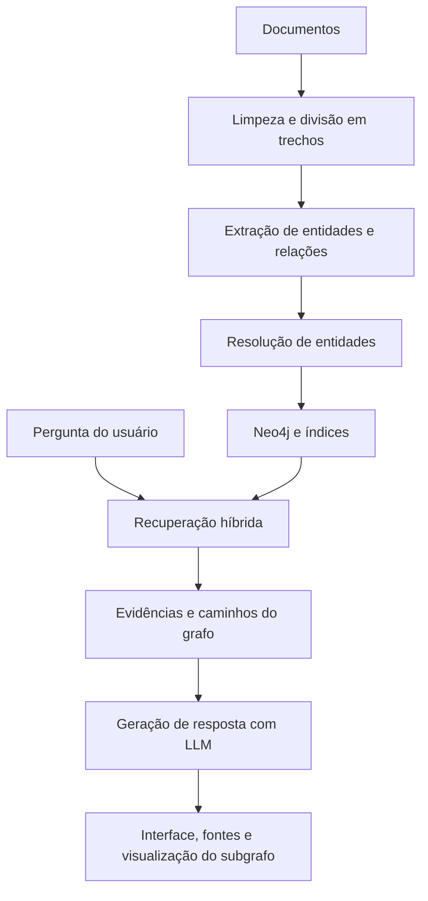

# Assistente_BDGraph

Projeto acadêmico da disciplina **Tendências em Ciência da Computação**, desenvolvido por uma equipe de seis integrantes.

O objetivo é construir um assistente de perguntas e respostas sobre bancos de dados utilizando **GraphRAG/KAG**, **Neo4j** e **modelos de linguagem (LLMs)**, com respostas fundamentadas em documentos e visualização das evidências utilizadas.

> Sistema completo e avaliado: extração, grafo no Neo4j, recuperação híbrida, interface e comparação
> com RAG vetorial. Pendentes apenas a apresentação e a licença do código, listadas no fim.

## Objetivo

Investigar como a combinação de recuperação textual e grafos de conhecimento pode apoiar respostas rastreáveis e reduzir afirmações sem sustentação documental.

O sistema conecta informações distribuídas entre documentos e responde perguntas que exigem percorrer múltiplos relacionamentos, abstraindo-se corretamente quando o corpus não cobre a pergunta.

## Escopo da primeira versão

- **Fundamentos:** banco de dados, SGBD, modelo relacional, tabelas, linhas e colunas.
- **Modelagem relacional:** entidades, atributos, relacionamentos, cardinalidades, chaves e integridade referencial.
- **Normalização:** dependências funcionais e formas normais até a 3FN.
- **SQL básico:** SELECT, FROM, WHERE, JOIN, GROUP BY, HAVING e funções de agregação.

## Funcionalidades

- Extração automática de entidades e relações a partir dos documentos.
- Resolução de entidades para tratar nomes equivalentes e evitar duplicidades.
- Armazenamento do conhecimento no Neo4j.
- Configuração de restrições de unicidade e índices de propriedades, texto e vetores.
- Recuperação híbrida, combinando busca vetorial e consultas Cypher.
- Geração e validação de consultas Cypher com apoio de LLM.
- Travessia de dois ou mais relacionamentos e aplicação de algoritmo de grafo.
- Geração de respostas com referências às evidências recuperadas.
- Tratamento de perguntas sem evidências suficientes.
- Interface com visualização interativa do subgrafo, fontes, consulta Cypher e indicador de confiança com significado documentado.

## Arquitetura



## Base documental

O corpus inicial contém **9 documentos**, organizados em **31 trechos textuais**, provenientes de:

- **Database Design — 2nd Edition**, disponibilizado pelo BCcampus.
- **Documentação oficial do PostgreSQL 18**.

Os textos permanecem em inglês. A aplicação deverá permitir perguntas e respostas em português, com tratamento de termos equivalentes entre os idiomas.

A preparação do corpus preserva os documentos originais, exemplos SQL, metadados de origem e avisos de atribuição. Foram preparados **28 suplementos de figuras**, separados dos 31 trechos originais, totalizando **59 trechos**. Duas transcrições permanecem parciais, com incertezas registradas.

## Estado atual

- [x] Definição do tema e do escopo inicial.
- [x] Seleção e coleta dos nove documentos.
- [x] Limpeza e organização dos textos.
- [x] Divisão em trechos com identificação das fontes.
- [x] Verificação de integridade dos arquivos do corpus.
- [x] Complementação textual das figuras essenciais, com limitações documentadas.
- [x] Definição inicial do esquema do grafo e dos formatos de integração.
- [x] Primeira versão de extração local, resolução de nomes e revisão rastreável.
- [x] Revisão de 26 resumos/contextos e inclusão de cinco conceitos, com aprovação do usuário registrada.
- [x] Remissões contextuais de esquema ER, monovalorado e arquivo, sem fusão automática de conceitos.
- [ ] Ampliação da cobertura de relações e avaliação humana independente.
- [x] Configuração e ingestão no Neo4j — esquema, ingestão idempotente e verificação.
- [x] Recuperação híbrida, embeddings multilíngues e consultas multi-hop — `scripts/retrieval.py`.
- [x] Integração com LLM — Cypher compilado, respostas com fontes e nível de sustentação.
- [x] Interface e visualização — página de consulta com fontes, consulta Cypher e subgrafo
      interativo (`app/`), testada sem banco e sem modelo.
- [x] Avaliação com 15 perguntas e comparação GraphRAG/KAG vs. RAG vetorial — 60% contra 93%.
- [x] Artigo consolidado em formato SBC, com resultado da avaliação — `docs/artigo/artigo.pdf`.
- [ ] Apresentação e roteiro da demonstração.

## Organização do trabalho

| Frente | Responsabilidade |
|---|---|
| 1. Dataset e extração | Preparação documental, extração de entidades e relações e tratamento de duplicidades. |
| 2. Modelagem e Neo4j | Esquema do grafo, ingestão, restrições e índices. |
| 3. Recuperação | Busca híbrida, travessias multi-hop e algoritmo de grafo. |
| 4. LLM | Geração e validação de Cypher e respostas fundamentadas. |
| 5. Interface | Interação com o usuário e visualização das evidências. |
| 6. Avaliação e integração | Conjunto de avaliação, testes integrados e reprodução do sistema. |

Todos os integrantes contribuirão com documentação, testes, artigo e apresentação.

## Tecnologias

**Em uso:**
- Neo4j 5.26 Community e Cypher.
- `qwen3:8b` no Ollama (`qwen3:4b` é a alternativa mais rápida, com qualidade menor).
- `paraphrase-multilingual-MiniLM-L12-v2`, 384 dimensões, similaridade de cosseno.
- Interface FastAPI e uma página HTML/CSS/JS própria, sem dependência de CDN.

Os scripts de preparação e extração usam Python. Ollama e Qwen3 8B foram usados para a extração local.
O adaptador Gemini continua disponível, mas as tentativas iniciais não produziram extração validada.

## Reprodução do zero

Requisitos: Python 3.10 ou superior, Docker (ou um Neo4j 5.x local) e Ollama com o modelo baixado
(`ollama pull qwen3:8b`).

```bash
cp .env.example .env                      # preencha NEO4J_PASSWORD (mínimo 8 caracteres)
docker compose up -d                      # Neo4j em localhost:7474 (Browser) e :7687 (Bolt)
python -m pip install -r requirements-extraction.txt
python -m pip install -r requirements-neo4j.txt -r requirements-retrieval.txt -r requirements-interface.txt
python scripts/neo4j_ingest.py schema                          # restrições e índices
python scripts/neo4j_ingest.py ingest --include-sample         # grava e verifica as contagens
python scripts/retrieval.py ingest-embeddings                  # 59 vetores no índice vetorial
python -m uvicorn app.interface:app --host 127.0.0.1 --port 8000
```

Abrir `http://127.0.0.1:8000` e perguntar. O modo `hybrid` não precisa do Neo4j no ar; o modo
`graph` precisa. Para refazer a avaliação: `python scripts/run-avaliacao.py --out work/avaliacao/rodada1`.
Testes: `python -m pytest -q` — na versão atual, **210 passam** e 2 são pulados (exigem
`NEO4J_TEST=1` com o banco no ar).

## Conferir os dados da extração

Para conferir a amostra manual (PowerShell 7):

```powershell
pwsh -NoProfile -File scripts/validate-extraction.ps1
```

A consolidação é exercitada pela suíte inteira (`python -m pytest -q`).

A amostra inicial contém 12 conceitos e 9 relações e permanece identificada como manual. As saídas atuais de regras e LLM foram executadas e revisadas separadamente; a extração ainda não é exaustiva.

- [Entrega para a parte 2 e critérios de ingestão](docs/entrega-parte1-para-parte2.md)
- [Contrato de dados](docs/contrato-extracao.md)
- [Modelo do grafo e ingestão no Neo4j](docs/modelo-grafo.md)
- [O que a parte 2 entrega para as partes 3, 4, 5 e 6](docs/handoff-parte2.md)
- [Preparação e qualidade do corpus](corpus/README.md)
- [Consolidação das extrações](docs/consolidacao-extracao.md)
- [Configuração da API Gemini](docs/configuracao-gemini.md)
- [ZIP da entrega inicial para a parte 2](outputs/parte1-para-parte2.zip)

A saída da extração é consumida pela ingestão: os três arquivos principais de
`data/release/current.json` são a fonte do grafo (93 conceitos, 16 relações; 23 com a amostra
opcional).

Senhas, credenciais do Neo4j e chaves de API não devem ser versionadas. As configurações necessárias serão exemplificadas em um arquivo `.env.example`, sem valores secretos.

## Base revisada para integração

A entrega atual contém **93 conceitos únicos e 16 relações semânticas únicas**, deduplicando IDs/triplas dos três arquivos indicados em [data/release/current.json](data/release/current.json). Não inclui a amostra manual inicial opcional nesses totais.

| Origem | Arquivo principal | Conteúdo |
|---|---|---|
| Regras e curadoria | [Base por regras](data/extraction/rule-knowledge-union-v2/extraction.json) | 79 conceitos e 5 relações |
| LLM e curadoria | [Base derivada do modelo](data/extraction/model-knowledge-union-v3/extraction.json) | 20 conceitos e 11 relações |
| Curadoria manual assistida por IA | [Conceitos acrescentados na revisão](data/extraction/manual-source-review-v1/extraction.json) | 5 conceitos e nenhuma nova relação |

As 26 correções de resumos/contextos e os cinco conceitos acrescentados foram [aprovados pelo usuário](data/review/user-approval-source-check-v1.json), com vínculo aos hashes da entrega. Essa aprovação não equivale a revisão independente de todos os conceitos/relações ou avaliação do sistema final. Os cinco conceitos novos são n-ário, ternário, decomposição de dependências, união de dependências e 2FN.

Os conceitos compartilhados devem ser atualizados por ID, reunindo aliases e evidências e preservando os métodos. Importar somente os três primary_files do índice atual. Candidatos, versões históricas, controles sintéticos e respostas rejeitadas **não são fatos adicionais aprovados**.

O [registro de remissões contextuais](data/normalization/contextual-aliases-v1.json) é auxiliar à busca, não um quarto arquivo de fatos. Esquema ER/modelo ER e monovalorado/simples estão restritos a D02; arquivo/relação está restrito a D09. O resolvedor exige contexto e nunca autoriza fusão de nós. A exceção de FD em D05_C002 exige revisão do contexto. Essa etapa foi conferida por Codex, sem aprovação humana posterior presumida.

- [Guia atualizado para a pessoa 2](docs/entrega-parte1-atualizada.md)
- [Resumos corrigidos e evidências](docs/revisao-fontes-2026-11-09.md)
- [Lista dos 93 conceitos para conferência](docs/lista-revisao-atual.md)
- [Fechamento das três pendências](docs/fechamento-pendencias.md)
- [D05 para leitura, com tabelas em Markdown](corpus/reading/D05.md)
- [Resultados e limitações de SQL](docs/cobertura-sql.md)
- [Execução local no computador principal](docs/modelo-local-principal.md)
- [Pacote atual completo e auditoria](outputs/entrega-parte1-pendencias-concluidas.zip)

corpus/reading contém cópias para leitura: seis tabelas de D05 foram formatadas em Markdown e o quadro explicativo de D08 foi mantido sem cabeçalho inventado. A extração continua usando corpus/processed e corpus/chunks, cujos bytes foram preservados. As cópias de leitura não criam novos documentos/chunks nem substituem evidências.

Use o esquema deste repositório, compatível com 0.1.0, 0.1.1 e 0.1.2. Os tipos SQL adicionais exigem 0.1.2. Para validar os dados entregues, não é necessário ter Ollama ou chave de API:

```powershell
pwsh -NoProfile -File scripts/validate-extraction.ps1 -ExtractionPath data/extraction/rule-knowledge-union-v2/extraction.json
pwsh -NoProfile -File scripts/validate-extraction.ps1 -ExtractionPath data/extraction/model-knowledge-union-v3/extraction.json
pwsh -NoProfile -File scripts/validate-extraction.ps1 -ExtractionPath data/extraction/manual-source-review-v1/extraction.json
python scripts/resolve-contextual-alias.py --term "file" --chunk D09_C003
```

A suíte inteira soma **210 testes**, com 2 pulados (dependem de `NEO4J_TEST=1`). Os hashes, IDs e
evidências literais dos três arquivos foram conferidos. Permanecem problemas nas fontes, duas
transcrições parciais e cobertura limitada de relações. A ingestão no Neo4j foi executada e
verificada, e a comparação com RAG vetorial está medida logo abaixo.

## Parte 4: LLM, Cypher e respostas fundamentadas

Estado: implementado, testado sem banco e sem modelo, e executado de ponta a ponta com o Neo4j 5.26
e o `qwen3:8b` — 45 execuções medidas na avaliação. Contrato completo em
[docs/contrato-llm.md](docs/contrato-llm.md) e seção do artigo em
[docs/artigo-parte4.md](docs/artigo-parte4.md).

- Geração e validação segura de Cypher: o modelo escolhe um plano em vocabulário fechado e o
  sistema compila, ou valida Cypher livre contra rótulos, tipos, propriedades, orçamento de saltos
  e `LIMIT` obrigatório (`scripts/guard-cypher.py`).
- Conjunto de 38 casos de contorno em `data/llm/testes/cypher-ataques.jsonl` (32 recusas
  obrigatórias, 5 controles e 1 limite conhecido registrado), executado por
  `tests/test_cypher_redteam.py`.
- Execução em modo leitura (`routing_=READ`) e montagem do pacote de evidências a partir dos
  caminhos do grafo (`scripts/neo4j-executor.py`).
- Respostas com citação por afirmação, fontes resolvidas em trecho e URL, recusa explícita de
  citação inventada e nível de sustentação calculado por regras, não pelo modelo
  (`scripts/answer-grounding.py`).
- Adaptador do modelo local com `--bundle`, `--neo4j`, `--replay` e `--dry-run`
  (`scripts/run-answer-ollama.py`); sem evidência recuperada, abstém-se sem chamar o modelo.

```powershell
# sem modelo e sem banco: valida o prompt e o Cypher compilado
python scripts/run-answer-ollama.py --bundle data/llm/exemplos/caminho-integridade-join.json --dry-run

# com o Neo4j da parte 2 no ar: confere a conexão e as contagens
python scripts/neo4j-executor.py --plan data/llm/exemplos/plano-integridade-join.json `
    --question "..." --check
```

## Parte 5: Interface e visualização

Estado: implementada e testada com o grafo da parte 2 no ar; a pergunta livre é convertida em
plano validado e a tela mostra resposta, fontes, consulta Cypher e subgrafo. Guia completo em
[docs/interface-parte5.md](docs/interface-parte5.md) e seção do artigo em
[docs/artigo-parte5.md](docs/artigo-parte5.md).

```bash
python -m pip install -r requirements-interface.txt
python -m uvicorn app.interface:app --host 127.0.0.1 --port 8000   # abrir http://127.0.0.1:8000
```

- Pergunta livre → plano de consulta construído a partir de um caminho que existe no grafo,
  revalidado pelo `guard-cypher.py` da parte 4 (`app/planner.py`).
- Fila de um trabalho por vez, com estados distintos para `done`, `unmatched`, `rejected` e
  `error` — recusa aparece como recusa (`app/interface.py`).
- Dois modos de recuperação no seletor da tela: **híbrido** (vetor + grafo, `scripts/retrieval.py`,
  não exige Neo4j no ar) e **grafo** (plano de consulta validado, mostra o Cypher executado).
- Apresentação de afirmações com identificador de evidência, painel de sustentação, citações
  literais por documento, Cypher executado e subgrafo em SVG, sem dependência de CDN
  (`app/static/`).
- 17 testes sem banco e sem modelo (`tests/test_interface.py`).

## Avaliação

Conjunto de **15 perguntas** em `data/avaliacao/perguntas.jsonl`: 5 conceituais, 5 multi-hop
(caminhos que existem no grafo) e 5 sem resposta no corpus. Cada pergunta traz o gabarito de
conceitos e de documentos de origem, derivado das evidências das relações do grafo — nunca das
respostas.

```bash
python scripts/run-avaliacao.py --out work/avaliacao/rodada1                        # três modos
python scripts/run-avaliacao.py --out work/avaliacao/rodada1 --modes vector,hybrid  # comparação
python scripts/run-avaliacao.py --dry-run --only Q01,Q11                            # só o encanamento
```

Três modos são comparados com o **mesmo modelo, o mesmo prompt e as mesmas regras de
verificação**, variando apenas a recuperação:

| Modo | Recuperação |
|---|---|
| `vector` | só busca vetorial sobre os 59 trechos (baseline RAG) |
| `hybrid` | busca vetorial + travessia do grafo (GraphRAG/KAG) |
| `graph` | plano de consulta Cypher validado executado no Neo4j |

Acerto, aplicado igualmente aos três: pergunta com resposta exige `answered`, ao menos um
documento esperado entre as fontes citadas e nenhuma citação não verificada; pergunta sem
resposta exige abstenção. Nível de sustentação e cobertura são reportados à parte, porque medem
outra coisa. Os resultados de cada rodada ficam em `work/avaliacao/<rodada>/` (`resultados.csv`
e `resumo.md`).

Rodada de 12/11/2026 (45 execuções, `qwen3:8b`): **`vector` 9/15 (60%)**, **`hybrid` 14/15
(93%)** e **`graph` 14/15 (93%)**; no grupo multi-hop, 1/5 contra 4/5 e 5/5; abstenção correta
5/5 nos três modos e nenhuma citação não verificada. Método, tabelas por pergunta e ameaças à
validade em [docs/avaliacao.md](docs/avaliacao.md); seção do artigo em
[docs/artigo-parte6.md](docs/artigo-parte6.md).

## Artigo

Versão consolidada das seis etapas em [docs/artigo/artigo.md](docs/artigo/artigo.md) (Markdown,
para revisão) e [docs/artigo/artigo.pdf](docs/artigo/artigo.pdf) (7 páginas, compilado do
`artigo.tex` com `pdflatex`). As seções por etapa continuam em `docs/artigo-parte4.md`,
`docs/artigo-parte5.md`, `docs/artigo-parte6.md` e nos documentos técnicos das partes 1 a 3.

**Pendente:** nomes, afiliação e e-mail dos integrantes (marcados como `Autor 1..6` no `.tex`) e a
escolha do formato final, SBC ou IEEE.

```bash
cd docs/artigo && pdflatex artigo.tex && pdflatex artigo.tex   # duas passadas pelas referências
```

## Entregas

- Código-fonte e instruções de execução.
- Sistema funcional com interface e visualização do grafo.
- Testes e resultados de avaliação.
- Artigo técnico em formato SBC ou IEEE.
- Apresentação e demonstração do sistema.

## Fontes e atribuições

- [Database Design — 2nd Edition](https://opentextbc.ca/dbdesign01/)
- [Tutorial do PostgreSQL 18](https://www.postgresql.org/docs/18/tutorial.html)

Os materiais do corpus mantêm suas respectivas licenças e atribuições, incluindo avisos específicos de conteúdo de terceiros. Essas condições devem acompanhar sua redistribuição.

A licença do código desenvolvido pela equipe ainda será definida.
