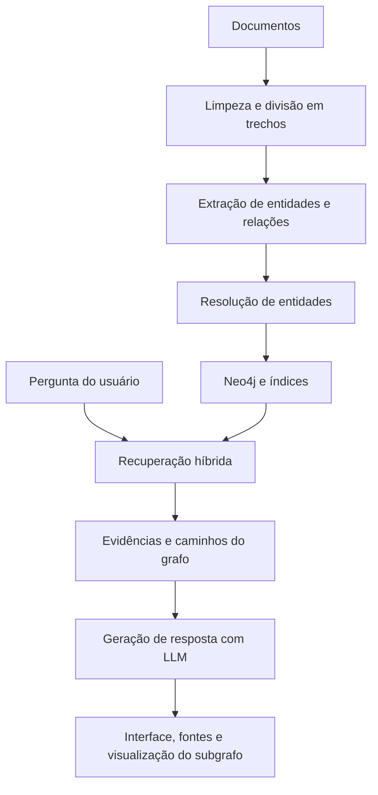

# Assistente_BDGraph

Projeto acadêmico da disciplina **Tendências em Ciência da Computação**, desenvolvido por uma equipe de seis integrantes.

O objetivo é construir um assistente de perguntas e respostas sobre bancos de dados utilizando **GraphRAG/KAG**, **Neo4j** e **modelos de linguagem (LLMs)**, com respostas fundamentadas em documentos e visualização das evidências utilizadas.

> Projeto em desenvolvimento. As funcionalidades descritas como previstas ainda serão implementadas.

## Objetivo

Investigar como a combinação de recuperação textual e grafos de conhecimento pode apoiar respostas rastreáveis e reduzir afirmações sem sustentação documental.

O sistema deverá conectar informações distribuídas entre documentos, permitindo responder perguntas que exijam percorrer múltiplos relacionamentos.

## Escopo da primeira versão

- **Fundamentos:** banco de dados, SGBD, modelo relacional, tabelas, linhas e colunas.
- **Modelagem relacional:** entidades, atributos, relacionamentos, cardinalidades, chaves e integridade referencial.
- **Normalização:** dependências funcionais e formas normais até a 3FN.
- **SQL básico:** SELECT, FROM, WHERE, JOIN, GROUP BY, HAVING e funções de agregação.

## Funcionalidades previstas

- Extração automática de entidades e relações a partir dos documentos.
- Resolução de entidades para tratar nomes equivalentes e evitar duplicidades.
- Armazenamento do conhecimento no Neo4j.
- Configuração de restrições de unicidade e índices de propriedades, texto e vetores.
- Recuperação híbrida, combinando busca vetorial e consultas Cypher.
- Geração e validação de consultas Cypher com apoio de LLM.
- Travessia de dois ou mais relacionamentos e aplicação de algoritmo de grafo.
- Geração de respostas com referências às evidências recuperadas.
- Tratamento de perguntas sem evidências suficientes.
- Interface com visualização interativa do subgrafo, fontes, consulta Cypher e indicador de confiança com significado documentado.

## Arquitetura prevista



## Base documental

O corpus inicial contém **9 documentos**, organizados em **31 trechos textuais**, provenientes de:

- **Database Design — 2nd Edition**, disponibilizado pelo BCcampus.
- **Documentação oficial do PostgreSQL 18**.

Os textos permanecem em inglês. A aplicação deverá permitir perguntas e respostas em português, com tratamento de termos equivalentes entre os idiomas.

A preparação do corpus preserva os documentos originais, exemplos SQL, metadados de origem e avisos de atribuição. Foram preparados **28 suplementos de figuras**, separados dos 31 trechos originais, totalizando **59 trechos**. Duas transcrições permanecem parciais, com incertezas registradas.

## Estado atual

- [x] Definição do tema e do escopo inicial.
- [x] Seleção e coleta dos nove documentos.
- [x] Limpeza e organização dos textos.
- [x] Divisão em trechos com identificação das fontes.
- [x] Verificação de integridade dos arquivos do corpus.
- [x] Complementação textual das figuras essenciais, com limitações documentadas.
- [x] Definição inicial do esquema do grafo e dos formatos de integração.
- [ ] Extração automática e resolução de entidades.
- [ ] Configuração e ingestão no Neo4j.
- [ ] Recuperação híbrida e consultas multi-hop.
- [ ] Integração com LLM.
- [ ] Interface e visualização.
- [ ] Avaliação, artigo técnico e apresentação.

## Organização do trabalho

| Frente | Responsabilidade |
|---|---|
| 1. Dataset e extração | Preparação documental, extração de entidades e relações e tratamento de duplicidades. |
| 2. Modelagem e Neo4j | Esquema do grafo, ingestão, restrições e índices. |
| 3. Recuperação | Busca híbrida, travessias multi-hop e algoritmo de grafo. |
| 4. LLM | Geração e validação de Cypher e respostas fundamentadas. |
| 5. Interface | Interação com o usuário e visualização das evidências. |
| 6. Avaliação e integração | Conjunto de avaliação, testes integrados e reprodução do sistema. |

Todos os integrantes contribuirão com documentação, testes, artigo e apresentação.

## Tecnologias

**Definidas pelo projeto:**
- Neo4j e Cypher.
- Modelo de linguagem.
- Modelo de embeddings.

Os scripts de preparação e extração usam Python. O adaptador inicial da API Gemini está implementado; a execução local com Ollama está sendo avaliada. A escolha final dos modelos, embeddings e interface permanece em aberto.

## Instalação e execução

Para conferir a amostra manual (PowerShell 7):

```powershell
pwsh -NoProfile -File scripts/validate-extraction.ps1
```

Para testar a consolidação (Python 3.10 ou superior):

```powershell
python -m pip install -r requirements-extraction.txt
python -m unittest discover -s tests -p test_consolidation.py -v
```

A amostra contém 12 conceitos e 9 relações, com 21 evidências literais. Ela é manual e não representa extração automática concluída.

- [Entrega para a parte 2 e critérios de ingestão](docs/entrega-parte1-para-parte2.md)
- [Contrato de dados](docs/contrato-extracao.md)
- [Preparação e qualidade do corpus](corpus/README.md)
- [Consolidação das extrações](docs/consolidacao-extracao.md)
- [Configuração da API Gemini](docs/configuracao-gemini.md)
- [ZIP da entrega inicial para a parte 2](outputs/parte1-para-parte2.zip)

No estado atual, ainda não há um assistente executável. O corpus e sua documentação já estão incluídos. O Neo4j e a aplicação ainda precisam ser implementados.

Senhas, credenciais do Neo4j e chaves de API não devem ser versionadas. As configurações necessárias serão exemplificadas em um arquivo `.env.example`, sem valores secretos.

## Avaliação planejada

A avaliação utilizará perguntas com respostas e evidências esperadas, incluindo:

- Perguntas conceituais simples.
- Perguntas que exigem múltiplos relacionamentos.
- Perguntas sem resposta na base documental.

Serão analisadas a correção das respostas, a recuperação das evidências e a rastreabilidade. Está prevista uma comparação com recuperação exclusivamente vetorial.

## Entregas

- Código-fonte e instruções de execução.
- Sistema funcional com interface e visualização do grafo.
- Testes e resultados de avaliação.
- Artigo técnico em formato SBC ou IEEE.
- Apresentação e demonstração do sistema.

## Fontes e atribuições

- [Database Design — 2nd Edition](https://opentextbc.ca/dbdesign01/)
- [Tutorial do PostgreSQL 18](https://www.postgresql.org/docs/18/tutorial.html)

Os materiais do corpus mantêm suas respectivas licenças e atribuições, incluindo avisos específicos de conteúdo de terceiros. Essas condições devem acompanhar sua redistribuição.

A licença do código desenvolvido pela equipe ainda será definida.
