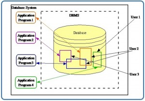
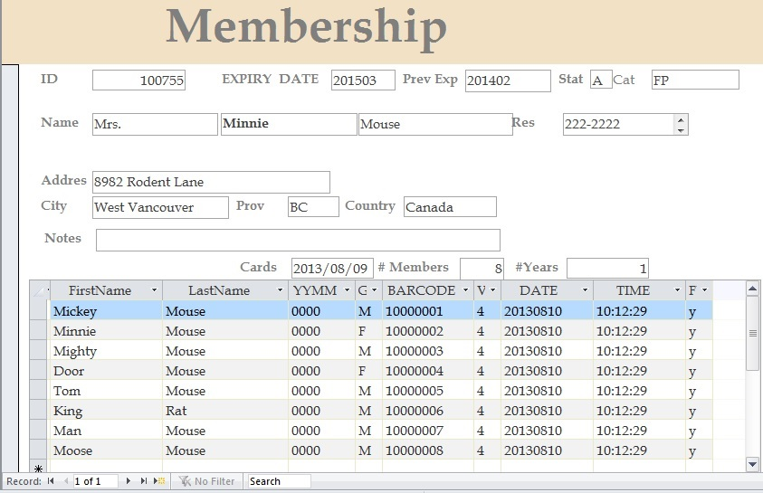

# Chapter 2 Fundamental Concepts

Adrienne Watt &amp; Nelson Eng

## What Is a Database?

A <em>database</em> is a shared collection of related data used to support the activities of a particular organization. A database can be viewed as a repository of data that is defined once and then accessed by various users as shown in Figure 2.1.

Figure 2.1. A database is a repository of data.

## Database Properties

A database has the following properties:

- It is a representation of some aspect of the real world or a collection of <em>data element</em>s (facts) representing real-world information.

- A database is logical, coherent and internally consistent.

- A database is designed, built and populated with data for a specific purpose.

- Each data item is stored in a field.

- A combination of fields makes up a <em>table</em>. For example, each field in an employee table contains data about an individual employee.

<em> </em>A database can contain many tables. For example, a membership system may contain an address table and an individual member table as shown in Figure 2.2. Members of Science World are individuals, group homes, businesses and corporations who have an active membership to Science World. Memberships can be purchased for a one- or two-year period, and then renewed for another one- or two-year period.

Figure 2.2. Membership system at Science World by N. Eng.

In Figure 2.2, Minnie Mouse renewed the family membership with Science World. Everyone with membership ID#100755  lives at 8932 Rodent Lane. The individual members are Mickey Mouse, Minnie Mouse, Mighty Mouse, Door Mouse, Tom Mouse, King Rat, Man Mouse and Moose Mouse.

## Database Management System

A <em>database management system (DBMS)</em> is a collection of programs that enables users to create and maintain databases and control all access to them. The primary goal of a DBMS is to provide an environment that is both convenient and efficient for users to retrieve and store information.

With the database approach, we can have the traditional banking system as shown in Figure 2.3. In this bank example, a DBMS is used by the Personnel Department, the Account Department and the Loan Department to access the shared corporate database.

[![There are three drawings on the left. The top one shows three people sitting and talking at a table; it is labelled as Personnel Dept. The drawing underneath this shows a man and woman in business attire and carrying briefcases shaking hands; it is labelled as Account Dept. The last drawing is of a woman; it is labelled Loan Dept. To the right of this is a rectangle with DBMS. to the right of this is a green cylinder that says Shared Database with employees, checking accounts, saving accounts, installment loans, mortgage loans, data files.](../raw/assets/D01_F003.jpg)](http://opentextbc.ca/dbdesign01/wp-content/uploads/sites/11/2013/12/Banking-Systems-RDBMS-300x1951.jpg)

Figure 2.3. A bank database management system (DBMS).

## Key Terms

<strong>data elements</strong>: facts that represent real-world information

<strong>database</strong>: a shared collection of related data used to support the activities of a particular organization

<strong>database management system (DBMS)</strong>: a collection of programs that enables users to create and maintain databases and control all access to them

<strong>table</strong>: a combination of fields

## Exercises

1. What is a database management system (DBMS)?

2. What are the properties of a DBMS?

3. Provide three examples of a real-world database (e.g., the library contains a database of books).

## Attribution

This chapter of <em>Database Design</em> (including images, except as otherwise noted) is a derivative copy of [Database System Concepts](http://cnx.org/contents/b57b8760-6898-469d-a0f7-06e0537f6817@1) by Nguyen Kim Anh licensed under [Creative Commons Attribution License 3.0 license](http://creativecommons.org/licenses/by/3.0/)

The following material was written by Nelson Eng:

1. Example under <em>Database Properties</em>

2. Key Terms

The following material was written by Adrienne Watt:

1. Exercises
