# Chapter 8 The Entity Relationship Data Model

Adrienne Watt

The <em>entity relationship (ER) data model</em> has existed for over 35 years. It is well suited to data modelling for use with databases because it is fairly abstract and is easy to discuss and explain. ER models are readily translated to relations. ER models, also called an ER schema, are represented by ER diagrams.

ER modelling is based on two concepts:

- Entities<em>,</em> defined as tables that hold specific information (data)

- <em>Relationships,</em> defined as the associations or interactions between entities

Here is an example of how these two concepts might be combined in an ER data model: Prof. Ba (entity) teaches (relationship) the Database Systems course (entity).

For the rest of this chapter, we will use a sample database called the COMPANY database to illustrate the concepts of the ER model. This database contains information about employees, departments and projects. Important points to note include:

- There are several departments in the company. Each department has a unique identification, a name, location of the office and a particular employee who manages the department.

- A department controls a number of projects, each of which has a unique name, a unique number and a budget.

- Each employee has a name, identification number, address, salary and birthdate. An employee is assigned to one department but can join in several projects. We need to record the start date of the employee in each project. We also need to know the direct supervisor of each employee.

- We want to keep track of the dependents for each employee. Each dependent has a name, birthdate and relationship with the employee.

## Entity, Entity Set and Entity Type

An <em>entity</em> is an object in the real world with an independent existence that can be differentiated from other objects. An entity might be

- An object with physical existence (e.g., a lecturer, a student, a car)

- An object with conceptual existence (e.g., a course, a job, a position)

Entities can be classified based on their strength. An entity is considered weak if its tables are existence dependent.

- That is, it cannot exist without a relationship with another entity

- Its primary key is derived from the primary key of the parent entity

  - The Spouse table, in the COMPANY database, is a weak entity because its primary key is dependent on the Employee table. Without a corresponding employee record, the spouse record would not exist.

An entity is considered strong if it can exist apart from all of its related entities.

- Kernels are strong entities.

- A table without a foreign key or a table that contains a foreign key that can contain nulls is a strong entity

Another term to know is <em>entity type</em> which defines a collection of similar entities.

An <em>entity set</em> is a collection of entities of an entity type at a particular point of time. In an entity relationship diagram (ERD), an entity type is represented by a name in a box. For example, in Figure 8.1, the entity type is EMPLOYEE.

Figure 8.1. ERD with entity type EMPLOYEE.

### Existence dependency

An entity’s existence is dependent on the existence of the related entity. It is existence-dependent if it has a mandatory foreign key (i.e., a foreign key attribute that cannot be null). For example, in the COMPANY database, a Spouse entity is existence -dependent on the Employee entity.

## Kinds of Entities

You should also be familiar with different kinds of entities including independent entities, dependent entities and characteristic entities. These are described below.

### Independent entities

<em>Independent entities</em>, also referred to as kernels, are the backbone of the database. They are what other tables are based on. <em>Kernels</em> have the following characteristics:

- They are the building blocks of a database.

- The primary key may be simple or composite.

- The primary key is not a foreign key.

- They do not depend on another entity for their existence.

If we refer back to our COMPANY database, examples of an independent entity include the Customer table, Employee table or Product table.

### Dependent entities

<em>Dependent entities</em>, also referred to as <em>derived entities</em>, depend on other tables for their meaning. These entities have the following characteristics:

- Dependent entities are used to connect two kernels together.

- They are said to be existence dependent on two or more tables.

- Many to many relationships become associative tables with at least two foreign keys.

- They may contain other attributes.

- The foreign key identifies each associated table.

- There are three options for the primary key:

  1. Use a composite of foreign keys of associated tables if unique

  2. Use a composite of foreign keys and a qualifying column

  3. Create a new simple primary key

### Characteristic entities

<em>Characteristic entities</em> provide more information about another table. These entities have the following characteristics:

- They represent multivalued attributes.

- They describe other entities.

- They typically have a one to many relationship.

- The foreign key is used to further identify the characterized table.

- Options for primary key are as follows:

  1. Use a composite of foreign key plus a qualifying column

  2. Create a new simple primary key. In the COMPANY database, these might include:

     - Employee (EID, Name, Address, Age, Salary) – EID is the simple primary key.

     - EmployeePhone (EID, Phone) – EID is part of a composite primary key. Here, EID is also a foreign key.

## Attributes

Each entity is described by a set of attributes (e.g., Employee = (Name, Address, Birthdate (Age), Salary).

Each attribute has a name, and is associated with an entity and a domain of legal values. However, the information about attribute domain is not presented on the ERD.

In the entity relationship diagram, shown in Figure 8.2, each attribute is represented by an oval with a name inside.

[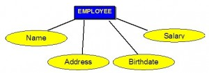](http://opentextbc.ca/dbdesign01/wp-content/uploads/sites/11/2013/12/Distributed-Systems-300x217.jpg)

Figure 8.2. How attributes are represented in an ERD.

## Types of Attributes

There are a few types of attributes you need to be familiar with. Some of these are to be left as is, but some need to be adjusted to facilitate representation in the relational model. This first section will discuss the types of attributes. Later on we will discuss fixing the attributes to fit correctly into the relational model.

### Simple attributes

<em>Simple attributes</em> are those drawn from the atomic value domains; they are also called <em>single-valued attributes</em>. In the COMPANY database, an example of this would be: Name = {John} ; Age = {23}

### Composite attributes

<em>Composite attributes</em> are those that consist of a hierarchy of attributes. Using our database example, and shown in Figure 8.3, Address may consist of Number, Street and Suburb. So this would be written as → Address = {59 + ‘Meek Street’ + ‘Kingsford’}

Figure 8.3. An example of composite attributes.

### Multivalued attributes

<em>Multivalued attributes</em> are attributes that have a set of values for each entity. An example of a multivalued attribute from the COMPANY database, as seen in Figure 8.4, are the degrees of an employee: BSc, MIT, PhD.

[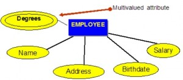](http://opentextbc.ca/dbdesign01/wp-content/uploads/sites/11/2013/12/Many-to-Many-Relationships-300x167.jpg)

Figure 8.4. Example of a multivalued attribute.

### Derived attributes

<em>Derived attributes</em> are attributes that contain values calculated from other attributes. An example of this can be seen in Figure 8.5. Age can be derived from the attribute Birthdate. In this situation, Birthdate is called a <em>stored attribute, </em>which is physically saved to the database.

[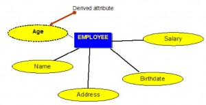](http://opentextbc.ca/dbdesign01/wp-content/uploads/sites/11/2013/12/Derived-Attribute-300x154.jpg)

Figure 8.5. Example of a derived attribute.

## Keys

An important constraint on an entity is the key. The <em>key</em> is an attribute or a group of attributes whose values can be used to uniquely identify an individual entity in an entity set.

## Types of Keys

There are several types of keys. These are described below.

### Candidate key

A <em>candidate key</em> is a simple or composite key that is unique and minimal. It is unique because no two rows in a table may have the same value at any time. It is minimal because every column is necessary in order to attain uniqueness.

From our COMPANY database example, if the entity is <strong>Employee</strong>(EID, First Name, Last Name, <em>SIN</em>, Address, Phone, BirthDate, Salary, DepartmentID), possible candidate keys are:

- EID, SIN

- First Name and Last Name – assuming there is no one else in the company with the same name

- Last Name and DepartmentID – assuming two people with the same last name don’t work in the same department

### Composite key

A <em>composite key</em> is composed of two or more attributes, but it must be minimal.

Using the example from the candidate key section, possible composite keys are:

- First Name and Last Name – assuming there is no one else in the company with the same name

- Last Name and Department ID – assuming two people with the same last name don’t work in the same department

### Primary key

The primary key is a candidate key that is selected by the database designer to be used as an identifying mechanism for the whole entity set. It must uniquely identify tuples in a table and not be null. The primary key is indicated in the ER model by underlining the attribute.

- A candidate key is selected by the designer to uniquely identify tuples in a table. It must not be null.

- A key is chosen by the database designer to be used as an identifying mechanism for the whole entity set. This is referred to as the primary key. This key is indicated by underlining the attribute in the ER model.

In the following example, EID is the primary key:

<strong>Employee</strong>(EID, First Name, Last Name, SIN, Address, Phone, BirthDate, Salary, DepartmentID)

### Secondary key

A <em>secondary key</em> is an attribute used strictly for retrieval purposes (can be composite), for example: Phone and Last Name.

### Alternate key

<em>Alternate keys</em> are all candidate keys not chosen as the primary key.

### Foreign key

A<em> foreign key (FK)</em> is an attribute in a table that references the primary key in another table OR it can be null. Both foreign and primary keys must be of the same data type.

In the COMPANY database example below, DepartmentID is the foreign key:

<strong>Employee</strong>(EID, First Name, Last Name, SIN, Address, Phone, BirthDate, Salary, DepartmentID)

## Nulls

A<em> null</em> is a special symbol, independent of data type, which means either unknown or inapplicable. It does not mean zero or blank. Features of null include:

- No data entry

- Not permitted in the primary key

- Should be avoided in other attributes

- Can represent

  - An unknown attribute value

  - A known, but missing, attribute value

  - A “not applicable” condition
- Can create problems when functions such as COUNT, AVERAGE and SUM are used

- Can create logical problems when relational tables are linked

NOTE: The result of a comparison operation is null when either argument is null. The result of an arithmetic operation is null when either argument is null (except functions that ignore nulls).

### Example of how null can be used

Use the Salary table (Salary\_tbl) in Figure 8.6 to follow an example of how null can be used.

[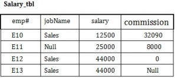](http://opentextbc.ca/dbdesign01/wp-content/uploads/sites/11/2013/12/SalaryTable-300x132.jpg)

Figure 8.6. Salary table for null example, by A. Watt.

To begin, find all employees (emp#) in Sales (under the jobName column) whose salary plus commission are greater than 30,000.

- SELECT emp# FROM Salary\_tbl

- WHERE jobName = Sales AND

- (commission + salary) &gt; 30,000 –&gt; E10 and E12

This result does not include E13 because of the null value in the commission column. To ensure that the row with the null value is included, we need to look at the individual fields. By adding commission and salary for employee E13, the result will be a null value. The solution is shown below.

- SELECT emp# FROM Salary\_tbl

- WHERE jobName = Sales AND

- (commission &gt; 30000 OR

- salary &gt; 30000 OR

- (commission + salary) &gt; 30,000 –&gt;E10 and E12 and E13

## Relationships

<em>Relationships</em> are the glue that holds the tables together. They are used to connect related information between tables.

<em>Relationship strength</em> is based on how the primary key of a related entity is defined. A weak, or non-identifying, relationship exists if the primary key of the related entity does not contain a primary key component of the parent entity. Company database examples include:

- Customer(<strong>CustID</strong>, CustName)

- Order(<strong>OrderID</strong>, CustID, Date)

A strong, or identifying, relationship exists when the primary key of the related entity contains the primary key component of the parent entity. Examples include:

- Course(<strong>CrsCode</strong>, DeptCode, Description)

- Class(<strong>CrsCode, Section</strong>, ClassTime…)

## Types of Relationships

Below are descriptions of the various types of relationships.

### One to many (1:M) relationship

A one to many (1:M) relationship should be the norm in any relational database design and is found in all relational database environments. For example, one department has many employees. Figure 8.7 shows the relationship of one of these employees to the department.

Figure 8.7. Example of a one to many relationship.

### One to one (1:1) relationship

A one to one (1:1) relationship is the relationship of one entity to only one other entity, and vice versa. It should be rare in any relational database design. In fact, it could indicate that two entities actually belong in the same table.

An example from the COMPANY database is one employee is associated with one spouse, and one spouse is associated with one employee.

### Many to many (M:N) relationships

For a many to many relationship, consider the following points:

- It cannot be implemented as such in the relational model.

- It can be changed into two 1:M relationships.

- It can be implemented by breaking up to produce a set of 1:M relationships.

- It involves the implementation of a composite entity.

- Creates two or more 1:M relationships.

- The composite entity table must contain at least the primary keys of the original tables.

- The linking table contains multiple occurrences of the foreign key values.

- Additional attributes may be assigned as needed.

- It can avoid problems inherent in an M:N relationship by creating a composite entity or bridge entity. For example, an employee can work on many projects OR a project can have many employees working on it, depending on the business rules. Or, a student can have many classes and a class can hold many students.

Figure 8.8 shows another another aspect of the M:N relationship where an employee has different start dates for different projects. Therefore, we need a JOIN table that contains the EID, Code and StartDate.

[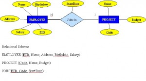](http://opentextbc.ca/dbdesign01/wp-content/uploads/sites/11/2013/12/One-to-Many-Relationships-300x137.jpg)

Figure 8.8. Example where employee has different start dates for different projects.

<strong>Example of mapping an M:N binary relationship type</strong>

- For each M:N binary relationship, identify two relations.

- A and B represent two entity types participating in R.

- Create a new relation S to represent R.

- S needs to contain the PKs of A and B. These together can be the PK in the S table OR these together with another simple attribute in the new table R can be the PK.

- The combination of the primary keys (A and B) will make the primary key of S.

### Unary relationship (recursive)

A <em>unary relationship, </em>also called <em>recursive, </em> is one in which a relationship exists between occurrences of the same entity set. In this relationship, the primary and foreign keys are the same, but they represent two entities with different roles. See Figure 8.9 for an example.

For some entities in a unary relationship, a separate column can be created that refers to the primary key of the same entity set.

[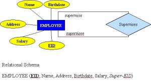](http://opentextbc.ca/dbdesign01/wp-content/uploads/sites/11/2013/12/Data-Abstraction-300x226.jpg)

Figure 8.9. Example of a unary relationship.

### Ternary Relationships

A <em>ternary relationship</em> is a relationship type that involves many to many relationships between three tables.

Refer to Figure 8.10 for an example of mapping a ternary relationship type. Note <em>n-ary</em> means multiple tables in a relationship. (Remember, N = many.)

- For each n-ary (&gt; 2) relationship, create a new relation to represent the relationship.

- The primary key of the new relation is a combination of the primary keys of the participating entities that hold the N (many) side.

- In most cases of an n-ary relationship, all the participating entities hold a <strong>many</strong> side.

[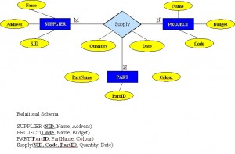](http://opentextbc.ca/dbdesign01/wp-content/uploads/sites/11/2013/12/Ternary-Mapping-Relationships-300x197.jpg)

Figure 8.10. Example of a ternary relationship.

## Key Terms

<strong>alternate key</strong>: all candidate keys not chosen as the primary key<strong>candidate key</strong>: a simple or composite key that is unique (no two rows in a table may have the same value) and minimal (every column is necessary)

<strong>characteristic entities</strong>: entities that provide more information about another table

<strong>composite attributes</strong>: attributes that consist of a hierarchy of attributes

<strong>composite key</strong>: composed of two or more attributes, but it must be minimal

<strong>dependent entities</strong>: these entities depend on other tables for their meaning

<strong>derived attributes</strong>: attributes that contain values calculated from other attributes

<strong>derived entities</strong>: see<em> dependent entities</em>

<strong>EID</strong>: employee identification (ID)

<strong>entity</strong>: a thing or object in the real world with an independent existence that can be differentiated from other objects

<strong>entity relationship (ER) data model</strong>: also called an ER schema, are represented by ER diagrams. These are well suited to data modelling for use with databases.

<strong>entity relationship schema</strong>: see<em> entity relationship data model</em>

<strong>entity set</strong>:a collection of entities of an entity type at a point of time

<strong>entity type</strong>: a collection of similar entities

<strong>foreign key (FK)</strong>: an attribute in a table that references the primary key in another table OR it can be null

<strong>independent entity</strong>: as the building blocks of a database, these entities are what other tables are based on

<strong>kernel</strong>: see<em> independent entity</em>

<strong>key</strong>: an attribute or group of attributes whose values can be used to uniquely identify an individual entity in an entity set

<strong>multivalued attributes</strong>: attributes that have a set of values for each entity

<strong>n-ary</strong>: multiple tables in a relationship

<strong>null</strong>: a special symbol, independent of data type, which means either unknown or inapplicable; it does not mean zero or blank

<strong>recursive relationship</strong>: see<em> unary relationship</em>

<strong>relationships</strong>: the associations or interactions between entities; used to connect related information between tables

<strong>relationship strength</strong>: based on how the primary key of a related entity is defined

<strong>secondary key</strong> an attribute used strictly for retrieval purposes

<strong>simple attributes</strong>: drawn from the atomic value domains

<strong>SIN</strong>: social insurance number

<strong>single-valued attributes</strong>: see<em> simple attributes</em>

<strong>stored attribute</strong>: saved physically to the database

<strong>ternary relationship</strong>: a relationship type that involves many to many relationships between three tables.

<strong>unary relationship</strong>: one in which a relationship exists between occurrences of the same entity set.

## Exercises

1. What two concepts are ER modelling based on?

2. The database in Figure 8.11 is composed of two tables. Use this figure to answer questions 2.1 to 2.5.

   [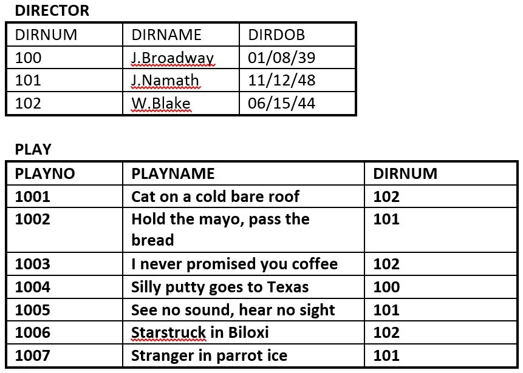](http://opentextbc.ca/dbdesign01/wp-content/uploads/sites/11/2014/03/Ch8-Exercises-Fig8-1-e1409188616109.jpg)

   Figure 8.11. Director and Play tables for question 2, by A. Watt.

   1. Identify the primary key for each table.

   2. Identify the foreign key in the PLAY table.

   3. Identify the candidate keys in both tables.

   4. Draw the ER model.

   5. Does the PLAY table exhibit referential integrity? Why or why not?
3. Define the following terms (you may need to use the Internet for some of these):  
    schema  
    host language  
    data sublanguage  
    data definition language  
    unary relation  
    foreign key  
    virtual relation  
    connectivity  
    composite key  
    linking table
4. The RRE Trucking Company database includes the three tables in Figure 8.12. Use Figure 8.12 to answer questions 4.1 to 4.5.

   [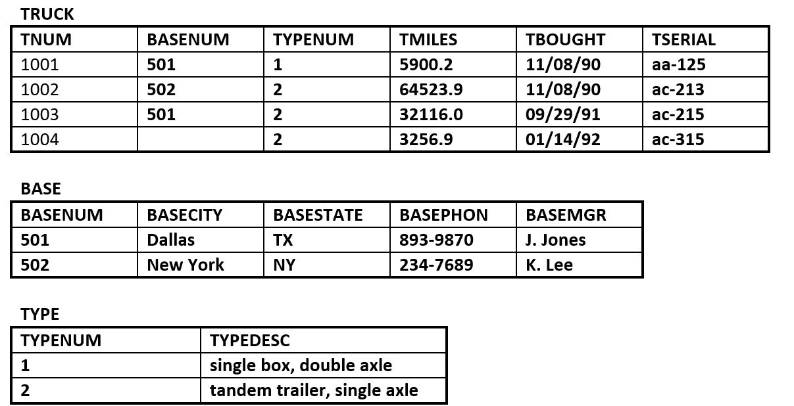](http://opentextbc.ca/dbdesign01/wp-content/uploads/sites/11/2014/03/Ch8-Exercises-Fig8-2-e1409189722961.jpg)

   Figure 8.12. Truck, Base and Type tables for question 4, by A. Watt.

   1. Identify the primary and foreign key(s) for each table.

   2. Does the TRUCK table exhibit entity and referential integrity? Why or why not? Explain your answer.

   3. What kind of relationship exists between the TRUCK and BASE tables?

   4. How many entities does the TRUCK table contain ?

   5. Identify the TRUCK table candidate key(s).

      [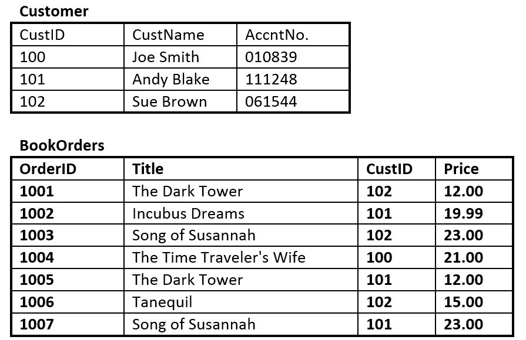](http://opentextbc.ca/dbdesign01/wp-content/uploads/sites/11/2014/03/Ch8-Exercises-Fig8-3-e1409189789204.jpg)

      Figure 8.13. Customer and BookOrders tables for question 5, by A. Watt.
5. Suppose you are using the database in Figure 8.13, composed of the two tables. Use Figure 8.13 to answer questions 5.1 to 5.6.

   1. Identify the primary key in each table.

   2. Identify the foreign key in the BookOrders table.

   3. Are there any candidate keys in either table?

   4. Draw the ER model.

   5. Does the BookOrders table exhibit referential integrity? Why or why not?

   6. Do the tables contain redundant data? If so which table(s) and what is the redundant data?
6. Looking at the student table in Figure 8.14, list all the possible candidate keys. Why did you select these?

   [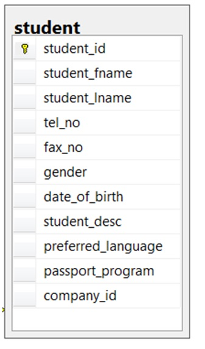](http://opentextbc.ca/dbdesign01/wp-content/uploads/sites/11/2014/03/Ch8-Exercises-No6-Student.jpg)

   Figure 8.14. Student table for question 6, by A. Watt.

   [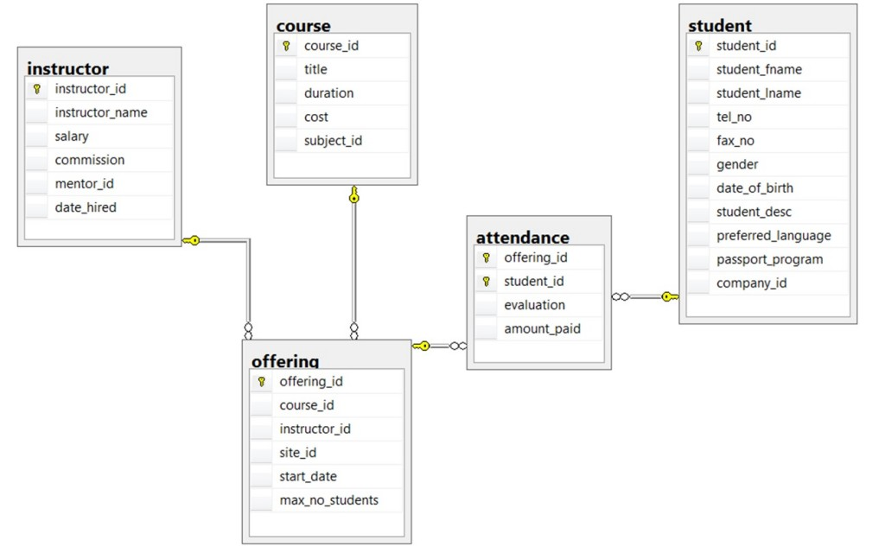](http://opentextbc.ca/dbdesign01/wp-content/uploads/sites/11/2014/03/Ch8-Exercises-No7-School-Database.jpg)

   Figure 8.15. ERD of school database for questions 7-10, by A. Watt.

   Use the ERD of a school database in Figure 8.15 to answer questions 7 to 10.
7. Identity all the kernels and dependent and characteristic entities in the ERD.

8. Which of the tables contribute to weak relationships? Strong relationships?

9. Looking at each of the tables in the school database in Figure 8.15, which attribute could have a NULL value? Why?

10. Which of the tables were created as a result of many to many relationships?

<strong>Also see</strong> <em>Appendix B: Sample ERD Exercises</em>

## Attribution

This chapter of <em>Database Design</em> (including images, except as otherwisse noted) is a derivative copy of [Data Modeling Using Entity-Relationship Model](http://cnx.org/contents/68cd9551-e453-420e-a906-d8e7e71260bb@1) by Nguyen Kim Anh licensed under [Creative Commons Attribution License 3.0 license](http://creativecommons.org/licenses/by/3.0/)

The following material was written by Adrienne Watt:

1. Nulls section and example

2. Key Terms

3. Exercises
