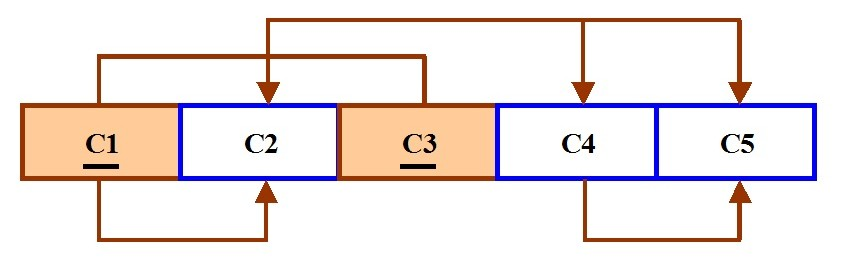
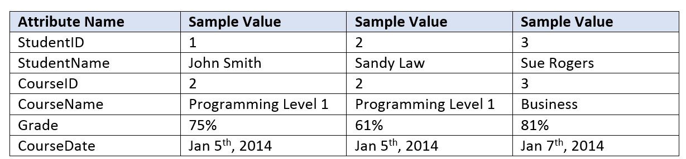
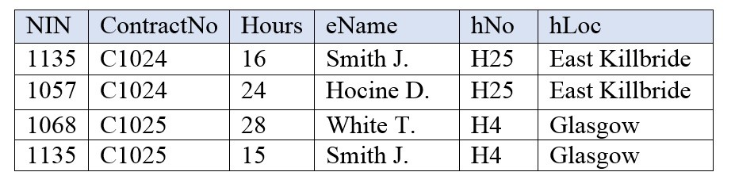

# Chapter 12 Normalization

Adrienne Watt

Normalization should be part of the database design process. However, it is difficult to separate the normalization process from the ER modelling process so the two techniques should be used concurrently.

Use an entity relation diagram (ERD) to provide the big picture, or macro view, of an organization’s data requirements and operations. This is created through an iterative process that involves identifying relevant entities, their attributes and their relationships.

Normalization procedure focuses on characteristics of specific entities and represents the micro view of entities within the ERD.

## What Is Normalization?

<em>Normalization</em> is the branch of relational theory that provides design insights. It is the process of determining how much redundancy exists in a table. The goals of normalization are to:

- Be able to characterize the level of redundancy in a relational schema

- Provide mechanisms for transforming schemas in order to remove redundancy

Normalization theory draws heavily on the theory of functional dependencies. Normalization theory defines six normal forms (NF). Each normal form involves a set of dependency properties that a schema must satisfy and each normal form gives guarantees about the presence and/or absence of update anomalies. This means that higher normal forms have less redundancy, and as a result, fewer update problems.

## Normal Forms

All the tables in any database can be in one of the normal forms we will discuss next. Ideally we only want minimal redundancy for PK to FK. Everything else should be derived from other tables. There are six normal forms, but we will only look at the first four, which are:

- First normal form (1NF)

- Second normal form (2NF)

- Third normal form (3NF)

- Boyce-Codd normal form (BCNF)

BCNF is rarely used.

## First Normal Form (1NF)

In the <em>first normal form</em>, only single values are permitted at the intersection of each row and column; hence, there are no repeating groups.

To normalize a relation that contains a repeating group, remove the repeating group and form two new relations.

The PK of the new relation is a combination of the PK of the original relation plus an attribute from the newly created relation for unique identification.

### Process for 1NF

We will use the <strong>Student\_Grade\_Report </strong>table below, from a School database, as our example to explain the process for 1NF.

<strong>Student\_Grade\_Report </strong>(StudentNo, StudentName, Major, CourseNo, CourseName, InstructorNo, InstructorName, InstructorLocation, Grade)

- In the Student Grade Report table, the repeating group is the course information. A student can take many courses.

- Remove the repeating group. In this case, it’s the course information for each student.

- Identify the PK for your new table.

- The PK must uniquely identify the attribute value (StudentNo and CourseNo).

- After removing all the attributes related to the course and student, you are left with the student course table (<strong>StudentCourse</strong>).

- The Student table (<strong>Student</strong>) is now in first normal form with the repeating group removed.

- The two new tables are shown below.

<strong>Student</strong> (StudentNo, StudentName, Major)

<strong>StudentCourse</strong> (StudentNo, CourseNo, CourseName, InstructorNo, InstructorName, InstructorLocation, Grade)

### How to update 1NF anomalies

<strong>StudentCourse</strong> (StudentNo, CourseNo, CourseName, InstructorNo, InstructorName, InstructorLocation, Grade)

- To add a new course, we need a student.

- When course information needs to be updated, we may have inconsistencies.

- To delete a <em>student,</em> we might also delete critical information about a course.

## Second Normal Form (2NF)

For the <em>second normal form</em>, the relation must first be in 1NF. The relation is automatically in 2NF if, and only if, the PK comprises a single attribute.

If the relation has a composite PK, then each non-key attribute must be fully dependent on the entire PK and not on a subset of the PK (i.e., there must be no partial dependency or augmentation).

### Process for 2NF

To move to 2NF, a table must first be in 1NF.

- The Student table is already in 2NF because it has a single-column PK.

- When examining the Student Course table, we see that not all the attributes are fully dependent on the PK; specifically, all course information. The only attribute that is fully dependent is grade.

- Identify the new table that contains the course information.

- Identify the PK for the new table.

- The three new tables are shown below.

<strong>Student</strong> (StudentNo, StudentName, Major)

<strong>CourseGrade</strong> (StudentNo, CourseNo, Grade)

<strong>CourseInstructor </strong>(CourseNo, CourseName, InstructorNo, InstructorName, InstructorLocation)

### How to update 2NF anomalies

- When adding a new instructor, we need a course.

- Updating course information could lead to inconsistencies for instructor information.

- Deleting a course may also delete instructor information.

## Third Normal Form (3NF)

To be in <em>third normal form</em>, the relation must be in second normal form. Also all transitive dependencies must be removed; a non-key attribute may not be functionally dependent on another non-key attribute.

### Process for 3NF

- Eliminate all dependent attributes in transitive relationship(s) from each of the tables that have a transitive relationship.

- Create new table(s) with removed dependency.

- Check new table(s) as well as table(s) modified to make sure that each table has a determinant and that no table contains inappropriate dependencies.

- See the four new tables below.

<strong>Student</strong> (StudentNo, StudentName, Major)

<strong>CourseGrade</strong> (StudentNo, CourseNo, Grade)

<strong>Course</strong> (CourseNo, CourseName, InstructorNo)

<strong>Instructor</strong> (InstructorNo, InstructorName, InstructorLocation)

At this stage, there should be no anomalies in third normal form. Let’s look at the dependency diagram (Figure 12.1) for this example. The first step is to remove repeating groups, as discussed above.

<strong>Student</strong> (StudentNo, StudentName, Major)

<strong>StudentCourse</strong> (StudentNo, CourseNo, CourseName, InstructorNo, InstructorName, InstructorLocation, Grade)

To recap the normalization process for the School database, review the dependencies shown in Figure 12.1.

Figure 12.1 Dependency diagram, by A. Watt.

The abbreviations used in Figure 12.1 are as follows:

- PD: partial dependency

- TD: transitive dependency

- FD: full dependency (Note: FD typically stands for <strong>functional</strong> dependency. Using FD as an abbreviation for full dependency is only used in Figure 12.1.)

## Boyce-Codd Normal Form (BCNF)

When a table has more than one candidate key, anomalies may result even though the relation is in 3NF. <em>Boyce-Codd normal form</em> is a special case of 3NF. A relation is in BCNF if, and only if, every determinant is a candidate key.

### BCNF Example 1

Consider the following table (<strong>St\_Maj\_Adv</strong>).

<table cellpadding="0" style="height: 126px; width: 202px; border-spacing: 0px;">
<tbody>
<tr>
<td valign="top"><strong>Student_id</strong></td>
<td valign="top"><strong>Major</strong></td>
<td valign="top"><strong>Advisor</strong></td>
</tr>
<tr>
<td valign="top">111</td>
<td valign="top">Physics</td>
<td valign="top">Smith</td>
</tr>
<tr>
<td valign="top">111</td>
<td style="text-align: left;" valign="top">Music</td>
<td valign="top">Chan</td>
</tr>
<tr>
<td valign="top">320</td>
<td valign="top">Math</td>
<td valign="top">Dobbs</td>
</tr>
<tr>
<td valign="top">671</td>
<td valign="top">Physics</td>
<td valign="top">White</td>
</tr>
<tr>
<td valign="top">803</td>
<td valign="top">Physics</td>
<td valign="top">Smith</td>
</tr>
</tbody>
</table>

The <em>semantic rules</em> (business rules applied to the database) for this table are:

1. Each Student may major in several subjects.

2. For each Major, a given Student has only one Advisor.

3. Each Major has several Advisors.

4. Each Advisor advises only one Major.

5. Each Advisor advises several Students in one Major.

The functional dependencies for this table are listed below. The first one is a candidate key; the second is not.

1. Student\_id, Major ——&gt; Advisor

2. Advisor ——&gt; Major

Anomalies for this table include:

1. Delete – student deletes advisor info

2. Insert – a new advisor needs a student

3. Update – inconsistencies

<strong>Note</strong>: No single attribute is a candidate key.

PK can be Student\_id, Major or Student\_id, Advisor<strong>.</strong>

To reduce the <strong>St\_Maj\_Adv</strong> relation to BCNF, you create two new tables:

1. <strong>St\_Adv</strong> (Student\_id, Advisor)

2. <strong>Adv\_Maj</strong> (Advisor, Major)

<strong>St\_Adv </strong>table <strong> </strong>

<table cellpadding="0" style="border-spacing: 0px;">
<tbody>
<tr>
<td valign="top"><strong>Student_id</strong></td>
<td valign="top"><strong>Advisor</strong></td>
</tr>
<tr>
<td valign="top">111</td>
<td valign="top">Smith</td>
</tr>
<tr>
<td valign="top">111</td>
<td valign="top">Chan</td>
</tr>
<tr>
<td valign="top">320</td>
<td valign="top">Dobbs</td>
</tr>
<tr>
<td valign="top">671</td>
<td valign="top">White</td>
</tr>
<tr>
<td valign="top">803</td>
<td valign="top">Smith</td>
</tr>
</tbody>
</table>

<strong>Adv\_Maj </strong>table<strong>  
 </strong>

<table cellpadding="0" style="border-spacing: 0px;">
<tbody>
<tr>
<td valign="top"><strong>Advisor</strong></td>
<td valign="top"><strong>Major</strong></td>
</tr>
<tr>
<td valign="top">Smith</td>
<td valign="top">Physics</td>
</tr>
<tr>
<td valign="top">Chan</td>
<td valign="top">Music</td>
</tr>
<tr>
<td valign="top">Dobbs</td>
<td valign="top">Math</td>
</tr>
<tr>
<td valign="top">White</td>
<td valign="top">Physics</td>
</tr>
</tbody>
</table>

### BCNF Example 2

Consider the following table (<strong>Client\_Interview)</strong>.

<table cellpadding="0" style="border-spacing: 0px;">
<tbody>
<tr>
<td valign="top"><strong>ClientNo</strong></td>
<td valign="top"><strong>InterviewDate</strong></td>
<td valign="top"><strong>InterviewTime</strong></td>
<td valign="top"><strong>StaffNo</strong></td>
<td valign="top"><strong>RoomNo</strong></td>
</tr>
<tr>
<td valign="top">CR76</td>
<td valign="top">13-May-02</td>
<td valign="top">10.30</td>
<td valign="top">SG5</td>
<td valign="top">G101</td>
</tr>
<tr>
<td valign="top">CR56</td>
<td valign="top">13-May-02</td>
<td valign="top">12.00</td>
<td valign="top">SG5</td>
<td valign="top">G101</td>
</tr>
<tr>
<td valign="top">CR74</td>
<td valign="top">13-May-02</td>
<td valign="top">12.00</td>
<td valign="top">SG37</td>
<td valign="top">G102</td>
</tr>
<tr>
<td valign="top">CR56</td>
<td valign="top">1-July-02</td>
<td valign="top">10.30</td>
<td valign="top">SG5</td>
<td valign="top">G102</td>
</tr>
</tbody>
</table>

FD1 – ClientNo, InterviewDate –&gt; InterviewTime, StaffNo, RoomNo (PK)

FD2 – staffNo, interviewDate, interviewTime –&gt; clientNO (candidate key: CK)

FD3 – roomNo, interviewDate, interviewTime –&gt; staffNo, clientNo (CK)

FD4 – staffNo, interviewDate –&gt; roomNo

A relation is in BCNF if, and only if, every determinant is a candidate key. We need to create a table that incorporates the first three FDs (<strong>Client\_Interview2 </strong>table) and another table (<strong>StaffRoom</strong> table) for the fourth FD.

<strong>Client\_Interview2 </strong>table

<table cellpadding="0" style="border-spacing: 0px;">
<tbody>
<tr>
<td valign="top"><strong>ClientNo</strong></td>
<td valign="top"><strong>InterviewDate</strong></td>
<td valign="top"><strong>InterViewTime</strong></td>
<td valign="top"><strong>StaffNo</strong></td>
</tr>
<tr>
<td valign="top">CR76</td>
<td valign="top">13-May-02</td>
<td valign="top">10.30</td>
<td valign="top">SG5</td>
</tr>
<tr>
<td valign="top">CR56</td>
<td valign="top">13-May-02</td>
<td valign="top">12.00</td>
<td valign="top">SG5</td>
</tr>
<tr>
<td valign="top">CR74</td>
<td valign="top">13-May-02</td>
<td valign="top">12.00</td>
<td valign="top">SG37</td>
</tr>
<tr>
<td valign="top">CR56</td>
<td valign="top">1-July-02</td>
<td valign="top">10.30</td>
<td valign="top">SG5</td>
</tr>
</tbody>
</table>

<strong>StaffRoom</strong> table

<table cellpadding="0" style="border-spacing: 0px;">
<tbody>
<tr>
<td valign="top"><strong>StaffNo</strong></td>
<td valign="top"><strong>InterviewDate</strong></td>
<td valign="top"><strong>RoomNo</strong></td>
</tr>
<tr>
<td valign="top">SG5</td>
<td valign="top">13-May-02</td>
<td valign="top">G101</td>
</tr>
<tr>
<td valign="top">SG37</td>
<td valign="top">13-May-02</td>
<td valign="top">G102</td>
</tr>
<tr>
<td valign="top">SG5</td>
<td valign="top">1-July-02</td>
<td valign="top">G102</td>
</tr>
</tbody>
</table>

## Normalization and Database Design

During the normalization process of database design, make sure that proposed entities meet required normal form before table structures are created. Many real-world databases have been improperly designed or burdened with anomalies if improperly modified during the course of time. You may be asked to redesign and modify existing databases. This can be a large undertaking if the tables are not properly normalized.

## Key Terms and Abbrevations

<strong>Boyce-Codd normal form (BCNF)</strong>: a special case of 3rd NF

<strong>first normal form (1NF): </strong>only single values are permitted at the intersection of each row and column so there are no repeating groups

<strong>normalization</strong>: the process of determining how much redundancy exists in a table

<strong>second normal form (2NF)</strong>: the relation must be in 1NF and the PK comprises a single attribute

<strong>semantic rules</strong>: business rules applied to the database

<strong>third normal form (3NF)</strong>: the relation must be in 2NF and all transitive dependencies must be removed; a non-key attribute may not be functionally dependent on another non-key attribute

## Exercises

<strong>Complete chapters 11 and 12 before doing these exercises.</strong>

1. What is normalization?

2. When is a table in 1NF?

3. When is a table in 2NF?

4. When is a table in 3NF?

5. Identify and discuss each of the indicated dependencies in the dependency diagram shown in Figure 12.2.

   

   Figure 12.2 For question 5, by A. Watt.
6. To keep track of students and courses, a new college uses the table structure in Figure 12.3.  
    Draw the dependency diagram for this table.

   

   Figure 12.3 For question 6, by A. Watt.
7. Using the dependency diagram you just drew, show the tables (in their third normal form) you would create to fix the problems you encountered. Draw the dependency diagram for the fixed table.

8. An agency called Instant Cover supplies part-time/temporary staff to hotels in Scotland. Figure 12.4 lists the time spent by agency staff working at various hotels. The national insurance number (NIN) is unique for every member of staff. Use Figure 12.4 to answer questions (a) and (b).

   

   Figure 12.4 For question 8, by A. Watt.

   1. This table is susceptible to update anomalies. Provide examples of insertion, deletion and update anomalies.

   2. Normalize this table to third normal form. State any assumptions.
9. Fill in the blanks:

   1. \_\_\_\_\_\_\_\_\_\_\_\_\_\_\_\_\_\_\_\_ produces a lower normal form.

   2. Any attribute whose value determines other values within a row is called a(n) \_\_\_\_\_\_\_\_\_\_\_\_\_\_\_\_\_\_\_\_.

   3. An attribute that cannot be further divided is said to display \_\_\_\_\_\_\_\_\_\_\_\_\_\_\_\_\_\_\_\_.

   4. \_\_\_\_\_\_\_\_\_\_\_\_\_\_\_\_\_\_\_\_ refers to the level of detail represented by the values stored in a table’s row.

   5. A relational table must not contain \_\_\_\_\_\_\_\_\_\_\_\_\_\_\_\_\_\_\_\_ groups.

<strong>Also see</strong> <em>Appendix B: Sample ERD Exercises</em>

## Bibliography

Nguyen Kim Anh,  <em>Relational Design Theory</em>. OpenStax CNX.  8 Jul 2009 Retrieved July 2014 from [http://cnx.org/contents/606cc532-0b1d-419d-a0ec-ac4e2e2d533b@1@1](http://cnx.org/contents/606cc532-0b1d-419d-a0ec-ac4e2e2d533b@1@1)

Russell, Gordon. Chapter 4 – Normalisation. <em>Database eLearning</em>. N.d. Retrived July 2014 from [db.grussell.org/ch4.html](https://opentextbc.ca/dbdesign01/chapter/chapter-12-normalization/db.grussell.org/ch4.html)
