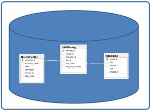
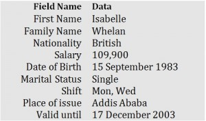
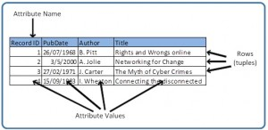
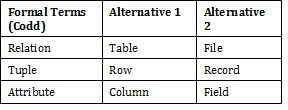
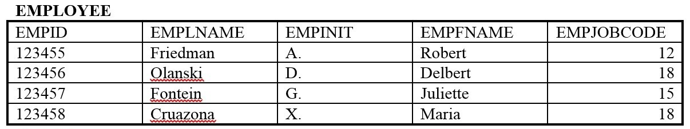

# Chapter 7 The Relational Data Model

Adrienne Watt

The relational data model was introduced by E. F. Codd in 1970. Currently, it is the most widely used data model.

The relational model has provided the basis for:

- Research on the theory of data/relationship/constraint

- Numerous database design methodologies

- The standard database access language called s<em>tructured query language (SQL)</em>

- Almost all modern commercial database management systems

The relational data model describes the world as “a collection of inter-related relations (or tables).”

## Fundamental Concepts in the Relational Data Model

### Relation

A <em>relation, </em>also known as a <em>table</em> or <em>file</em>, is a subset of the Cartesian product of a list of domains characterized by a name. And within a table, each row represents a group of related data values. A <em>row</em>, or record, is also known as a <em>tuple</em>. The columns in a table is a field and is also referred to as an attribute. You can also think of it this way: an attribute is used to define the record and a record contains a set of attributes.

The steps below outline the logic between a relation and its domains.

1. Given<em> n</em> domains are denoted by D1, D2, … Dn

2. And<em> r</em> is a relation defined on these domains

3. Then r ⊆ D1×D2×…×Dn

### Table

A database is composed of multiple tables and each<em> </em>table holds the data. Figure 7.1 shows a database that contains three tables.

Figure 7.1. Database with three tables.

### Column

A database stores pieces of information or facts in an organized way. Understanding how to use and get the most out of databases requires us to understand that method of organization.

The principal storage units are called <em>columns</em> or <em>fields</em> or <em>attributes</em>. These house the basic components of data into which your content can be broken down. When deciding which fields to create, you need to think generically about your information, for example, drawing out the common components of the information that you will store in the database and avoiding the specifics that distinguish one item from another.

Look at the example of an ID card in Figure 7.2 to see the relationship between fields and their data.

Figure 7.2. Example of an ID card by A. Watt.

### Domain

A <em>domain</em> is the original sets of atomic values used to model data. By <em>atomic value</em>, we mean that each value in the domain is indivisible as far as the relational model is concerned. For example:

- The domain of Marital Status has a set of possibilities: Married, Single, Divorced.

- The domain of Shift has the set of all possible days: {Mon, Tue, Wed…}.

- The domain of Salary is the set of all floating-point numbers greater than 0 and less than 200,000.

- The domain of First Name is the set of character strings that represents names of people.

In summary, a domain is a set of acceptable values that a column is allowed to contain. This is based on various properties and the data type for the column. We will discuss data types in another chapter.

### Records

Just as the content of any one document or item needs to be broken down into its constituent bits of data for storage in the fields, the link between them also needs to be available so that they can be reconstituted into their whole form. Records allow us to do this. <em>Records</em> contain fields that are related, such as a customer or an employee. As noted earlier, a tuple is another term used for record.

Records and fields form the basis of all databases. A simple table gives us the clearest picture of how records and fields work together in a database storage project.

Figure 7.3. Example of a simple table by A. Watt.

The simple table example in Figure 7.3 shows us how fields can hold a range of different sorts of data. This one has:

- A Record ID field: this is an ordinal number; its data type is an integer.

- A PubDate field: this is displayed as day/month/year; its data type is date.

- An Author field: this is displayed as Initial. Surname; its data type is text.

- A Title field text: free text can be entered here.

You can command the database to sift through its data and organize it in a particular way. For example, you can request that a selection of records be limited by date: 1. all before a given date, 2. all after a given date or 3. all between two given dates. Similarly, you can choose to have records sorted by date. Because the field, or record, containing the data is set up as a Date field, the database reads the information in the Date field not just as numbers separated by slashes, but rather, as dates that must be ordered according to a calendar system.

### Degree

The <em>degree</em> is the number of attributes in a table. In our example in Figure 7.3, the degree is 4.

## Properties of a Table

- A table has a name that is distinct from all other tables in the database.

- There are no duplicate rows; each row is distinct.

- Entries in columns are atomic. The table does not contain repeating groups or multivalued attributes.

- Entries from columns are from the same domain based on their data type including:

  - number (numeric, integer, float, smallint,…)

  - character (string)

  - date

  - logical (true or false)
- Operations combining different data types are disallowed.

- Each attribute has a distinct name.

- The sequence of columns is insignificant.

- The sequence of rows is insignificant.

## Key Terms

<strong>atomic value</strong>: each value in the domain is indivisible as far as the relational model is concerned<strong>attribute</strong>: principle storage unit in a database

<strong>column: </strong>see <em>attribute</em>

<strong>degree</strong>: number of attributes in a table

<strong>domain</strong>: the original sets of atomic values used to model data; a set of acceptable values that a column is allowed to contain

<strong>field</strong>: see <em>attribute</em>

<strong>file</strong>:see<em> relation</em>

<strong>record</strong>: contains fields that are related; <em>see tuple</em>

<strong>relation</strong>: a subset of the Cartesian product of a list of domains characterized by a name; the technical term for table or file

<strong>row</strong>: <em>see tuple</em>

<strong>structured query language (SQL)</strong>: the standard database access language

<strong>table:</strong>see<em> relation</em>

<strong>tuple</strong>: a technical term for row or record

#### Terminology Key

Several of the terms used in this chapter are synonymous. In addition to the Key Terms above, please refer to Table 7.1 below. The terms in the Alternative 1 column are most commonly used.

Table 7.1. Terms and their synonyms by A. Watt.

## Exercises

<em> Use Table 7.2 to answer questions 1-4.</em>

1. Using correct terminology, identify and describe all the components in Table 7.2.

2. What is the possible domain for field EmpJobCode?

3. How many records are shown?

4. How many attributes are shown?

5. List the properties of a table.

Table 7.2. Table for exercise questions, by A. Watt.

## Attribution

This chapter of <em>Database Design</em> (including images, except as otherwise noted) is a derivative copy of [Relational Design Theory](http://cnx.org/contents/e5ac0441-0e54-4895-9112-fb3a4ee9bce1@1) by Nguyen Kim Anh licensed under [Creative Commons Attribution License 3.0 license](http://creativecommons.org/licenses/by/3.0/)

The following material was written by Adrienne Watt:

1. All or part of the sections on relations, tables, columns and degree

2. Key Terms

3. Exercises
