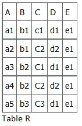
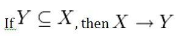
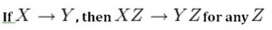
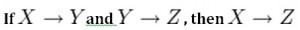
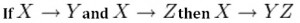
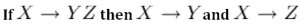
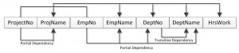

> Cópia para leitura. Tabelas e ênfases foram formatadas; não usar como origem de citações, offsets ou hashes de extração. Evidência original em corpus/processed e corpus/chunks.

# Chapter 11 Functional Dependencies

Adrienne Watt

A *functional dependency* (FD) is a relationship between two attributes, typically between the PK and other non-key attributes within a table. For any relation R, attribute Y is functionally dependent on attribute X (usually the PK), if for every valid instance of X, that value of X uniquely determines the value of Y. This relationship is indicated by the representation below :

**X ———–> Y**

The left side of the above FD diagram is called the *determinant*, and the right side is the *dependent*. Here are a few examples.

In the first example, below, SIN determines Name, Address and Birthdate. Given SIN, we can determine any of the other attributes within the table.

**SIN ———-> Name, Address, Birthdate**

For the second example, SIN and Course determine the date completed (DateCompleted). This must also work for a composite PK.

**SIN, Course ———> DateCompleted**

The third example indicates that ISBN determines Title.

**ISBN ———–> Title**

## Rules of Functional Dependencies

Consider the following table of data r(R) of the relation schema R(ABCDE) shown in Table 11.1.

Table 11.1. Functional dependency example, by A. Watt.

As you look at this table, ask yourself: *What kind of dependencies can we observe among the attributes in Table R?* Since the values of A are unique (a1, a2, a3, etc.), it follows from the FD definition that:

A → B, A → C, A → D, A → E

- It also follows that A →BC (or any other subset of ABCDE).

- This can be summarized as A →BCDE.

- From our understanding of primary keys, A is a primary key.

Since the values of E are always the same (all e1), it follows that:

A → E, B → E, C → E, D → E

However, we cannot generally summarize the above with ABCD → E  because, in general, A → E, B → E, AB → E.

Other observations:

1. Combinations of BC are unique, therefore BC → ADE.

2. Combinations of BD are unique, therefore BD → ACE.

3. If C values match, so do D values.

   1. Therefore, C → D

   2. However, D values don’t determine C values

   3. So C does not determine D, and D does not determine C.

Looking at actual data can help clarify which attributes are dependent and which are determinants.

## Inference Rules

*Armstrong’s axioms* are a set of inference rules used to infer all the functional dependencies on a relational database. They were developed by William W. Armstrong. The following describes what will be used, in terms of notation, to explain these axioms.

Let R(U) be a relation scheme over the set of attributes U. We will use the letters X, Y, Z to represent any subset of and, for short, the union of two sets of attributes, instead of the usual X U Y.

### Axiom of reflexivity

This axiom says, if Y is a subset of X, then X determines Y (see Figure 11.1).

Figure 11.1. Equation for axiom of reflexivity.

For example, **PartNo —> NT123** where X (PartNo) is composed of more than one piece of information; i.e., Y (NT) and partID (123).

### Axiom of augmentation

The axiom of augmentation, also known as a partial dependency, says if X determines Y, then XZ determines YZ for any Z (see Figure 11.2 ).

Figure 11.2. Equation for axiom of augmentation.

The axiom of augmentation says that every non-key attribute must be fully dependent on the PK. In the example shown below, StudentName, Address, City, Prov, and PC (postal code) are only dependent on the StudentNo, not on the StudentNo and Grade.

StudentNo, Course —> StudentName, Address, City, Prov, PC, Grade, DateCompleted

This situation is not desirable because every non-key attribute has to be fully dependent on the PK. In this situation, student information is only partially dependent on the PK (StudentNo).

To fix this problem, we need to break the original table down into two as follows:

- Table 1: StudentNo, Course, Grade, DateCompleted

- Table 2: StudentNo, StudentName, Address, City, Prov, PC

### Axiom of transitivity

The axiom of transitivity says if X determines Y, and Y determines Z, then X must also determine Z (see Figure 11.3).

Figure 11.3. Equation for axiom of transitivity.

The table below has information not directly related to the student; for instance, ProgramID and ProgramName should have a table of its own. ProgramName is not dependent on StudentNo; it’s dependent on ProgramID.

StudentNo —> StudentName, Address, City, Prov, PC, ProgramID, ProgramName

This situation is not desirable because a non-key attribute (ProgramName) depends on another non-key attribute (ProgramID).

To fix this problem, we need to break this table into two: one to hold information about the student and the other to hold information about the program.

- Table 1: StudentNo —> StudentName, Address, City, Prov, PC, ProgramID

- Table 2: ProgramID —> ProgramName  
   

However we still need to leave an FK in the student table so that we can identify which program the student is enrolled in.

### Union

This rule suggests that if two tables are separate, and the PK is the same, you may want to consider putting them together. It states that if X determines Y and X determines Z then X must also determine Y and Z (see Figure 11.4).

Figure 11.4. Equation for the Union rule.

For example, if:

- SIN —> EmpName

- SIN —> SpouseName

You may want to join these two tables into one as follows:

SIN –> EmpName, SpouseName

Some database administrators (*DBA*) might choose to keep these tables separated for a couple of reasons. One, each table describes a different entity so the entities should be kept apart. Two, if SpouseName is to be left NULL most of the time, there is no need to include it in the same table as EmpName.

### Decomposition

Decomposition is the reverse of the Union rule. If you have a table that appears to contain two entities that are determined by the same PK, consider breaking them up into two tables. This rule states that if X determines Y and Z, then X determines Y and X determines Z separately (see Figure 11.5).

Figure 11.5. Equation for decompensation rule.

## Dependency Diagram

A dependency diagram, shown in Figure 11.6, illustrates the various dependencies that might exist in a *non-normalized table*. A non-normalized table is one that has data redundancy in it.

Figure 11.6. Dependency diagram.

The following dependencies are identified in this table:

- ProjectNo and EmpNo, combined, are the PK.

- Partial Dependencies:

  - ProjectNo —> ProjName

  - EmpNo —> EmpName, DeptNo,

  - ProjectNo, EmpNo —> HrsWork
- Transitive Dependency:

  - DeptNo —> DeptName

## Key Terms

**Armstrong’s axioms**: a set of inference rules used to infer all the functional dependencies on a relational database**DBA**: database administrator

**decomposition**: a rule that suggests if you have a table that appears to contain two entities that are determined by the same PK, consider breaking them up into two tables

**dependent**: the right side of the functional dependency diagram

**determinant**: the left side of the functional dependency diagram

**functional dependency (FD):** a relationship between two attributes, typically between the PK and other non-key attributes within a table

**non-normalized table**: a table that has data redundancy in it

**Union**: a rule that suggests that if two tables are separate, and the PK is the same, consider putting them together

## Exercises

See Chapter 12.

## Attributions

This chapter of *Database Design* (including images, except as otherwise noted) is a derivative copy of [Armstrong’s axioms](http://en.wikipedia.org/wiki/Armstrong%27s_axioms) by Wikipedia the Free Encyclopedia licensed under [Creative Commons Attribution-ShareAlike 3.0 Unported](http://creativecommons.org/licenses/by-sa/3.0/)

The following material was written by Adrienne Watt:

1. some of Rules of Functional Dependencies

2. Key Terms
