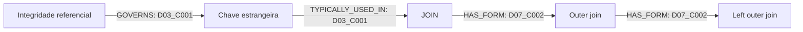

# Resultado da primeira amostra

Amostra manual de referência, produzida por Codex sobre D03_C001, D07_C001 e D07_C002. Não houve chamada a LLM externo nem extração automática de todo o corpus. A revisão não foi independente.

Foram registrados 12 conceitos, 9 relações explícitas e 21 referências a citações literais. As definições em português são sínteses e não citações traduzidas. Não foram modificados os 31 trechos originais nem os 28 suplementos.

## Exemplo de caminho

O caminho atravessa documentos distintos, mas sua existência não comprova melhoria da resposta ou redução de alucinações. Cada aresta mantém sua própria evidência. Uma pergunta orientadora é: "Como integridade referencial se relaciona com chaves estrangeiras e o uso típico dessas chaves em junções?". Uma consulta multi-hop será implementada posteriormente no Neo4j.

Não existe aresta que declare JOIN dependente de chave estrangeira. Não existe aresta incondicional afirmando que integridade referencial exige uma chave primária: a regra da fonte tem qualificações e não esgota todas as possibilidades de chaves referenciadas. A revisão conceitual mais ampla continua pendente.

## Verificações executadas

- JSON atende ao esquema 0.1.0.
- IDs canônicos, IDs de relação e triplas sem duplicação.
- Todos os endpoints correspondem a conceitos da amostra.
- As 21 citações são substrings exatas dos trechos indicados.
- Leitura conjunta dos 59 trechos sem colisões de ID.
- Teste negativo: evidência inventada rejeitada.
- Teste negativo: relação com conceito inexistente rejeitada.

O verificador não avalia automaticamente suficiência semântica, traduções, equivalência de aliases ou contradições. Os testes negativos cobrem dois casos relevantes; não constituem uma suíte exaustiva.

## Entrega aos responsáveis

- Parte 1: implementar candidatos por trecho, resolução de entidades e validação a partir deste contrato.
- Parte 2: usar o JSON como amostra de entrada, preservando evidências e IDs na ingestão. Criar também os nós de documento e trecho a partir do corpus.
- Partes 3 a 5: utilizar os caminhos como dados de exemplo, identificando que ainda não há execução real da recuperação nem do Neo4j.

Antes da extração automática, escolher modelo/provedor e ambiente. Não armazenar credenciais no repositório.
