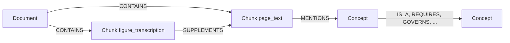

# Assistente de banco de dados com GraphRAG: extração de conhecimento, grafo no Neo4j, recuperação híbrida e respostas fundamentadas

> **Status deste documento.** Versão consolidada das seis etapas do projeto, escrita a partir dos
> documentos técnicos de cada parte e das medidas feitas nesta máquina. O PDF é gerado no template
> SBC (`artigo.tex`). Todos os números marcados como medidos foram obtidos com Neo4j 5.26.33,
> Ollama 0.40.16 e `qwen3:8b` em uma GTX 1650 com 4 GB e 23 GB de RAM.

**Autores:** João Pedro Coutinho Nóbrega, Lucas Bezerra Ribeiro Coutinho, Jefferson Coutinho da
Cunha Filho, Matheus Oliveira Aquino Leal Rodrigues, Ramon Sávio Fontes Rocha e Adijair Pinto Viana
Gonçalves de Araújo.

Centro Universitário de João Pessoa (UNIPÊ) — Curso de Bacharelado em Ciência da Computação —
Disciplina: Tendências em Ciência da Computação.

`j.nobrega@cs.unipe.edu.br`, `l.coutinho@cs.unipe.edu.br`, `jefferson.filho@cs.unipe.edu.br`,
`matheus.rodrigues@cs.unipe.edu.br`, `ramon.savio@cs.unipe.edu.br`,
`adijair.araujo@cs.unipe.edu.br`.

## Resumo

Assistentes que respondem perguntas sobre bancos de dados precisam de mais que fluência: precisam
de rastreabilidade. Este trabalho descreve um assistente que extrai conceitos e relações de nove
capítulos de material didático sobre bancos de dados relacionais e SQL, armazena esse
conhecimento em um grafo no Neo4j, recupera evidências por busca vetorial e por travessia de
grafo, e gera respostas em português com citação literal por afirmação e um nível de sustentação
calculado por regras — nunca pelo modelo. O sistema completo é avaliado em 15 perguntas: o modo
híbrido (vetor + grafo) acerta 93% contra 60% da busca puramente vetorial, diferença concentrada
nas perguntas que exigem dois ou mais relacionamentos (4 de 5 contra 1 de 5). Os três modos
abstiveram-se corretamente em todas as cinco perguntas fora do corpus, e nenhuma das 43 respostas
produzidas trouxe citação não verificada.

**Palavras-chave:** GraphRAG; KAG; Neo4j; recuperação híbrida; fundamentação de respostas; LLM.

## Abstract

Question answering over database documentation requires more than fluency: it requires
traceability. We describe an assistant that extracts concepts and relations from nine chapters of
relational database and SQL teaching material, stores that knowledge in a Neo4j graph, retrieves
evidence through vector search and graph traversal, and generates Portuguese answers with a
verbatim citation per claim and a support level computed by rules rather than by the model. The
full system is evaluated on 15 questions: the hybrid mode (vector + graph) answers 93% correctly
against 60% for pure vector search, a difference concentrated in questions that require two or
more relationships (4 of 5 against 1 of 5). All three modes abstained correctly on every one of
the five out-of-corpus questions, and none of the 43 answers carried an unverified citation.

**Keywords:** GraphRAG; KAG; Neo4j; hybrid retrieval; answer grounding; LLM.

## 1. Introdução

Modelos de linguagem respondem com fluência sobre bancos de dados e SQL, mas fluência não é
rastreabilidade. Em um contexto de ensino e de documentação técnica, uma resposta sem fonte
verificável tem o mesmo valor que uma resposta ausente: não se pode conferir, e não se pode
ensinar a conferir.

Este projeto parte de uma pergunta prática — *"a pergunta feita na interface consegue ser
respondida com informação de dois documentos reais, com fonte verificável e visualização do
grafo?"* — e a trata como restrição de projeto, não como aspiração. O sistema foi construído em
seis etapas encadeadas: extração de conhecimento do corpus, modelagem e ingestão em um grafo,
recuperação híbrida, geração validada por LLM, interface com visualização e avaliação comparativa.

As contribuições são:

1. Um contrato de extração com vocabulário fechado de rótulos, tipos de relação e propriedades,
   que permite validar automaticamente tudo o que entra no grafo.
2. Uma recuperação híbrida que soma busca vetorial multilíngue e travessia de grafo por fusão de
   ranks, com caminho mais curto e centralidade de grau.
3. Uma camada de geração que **não deixa o modelo escrever Cypher**: o modelo escolhe um plano em
   vocabulário fechado, e o sistema compila e valida a consulta.
4. Uma verificação de resposta que confere cada citação contra o texto original do corpus e
   calcula um nível de sustentação por regras explícitas.
5. Uma avaliação comparativa com 15 perguntas, medida nos três modos de recuperação.

## 2. Fundamentação e trabalhos relacionados

**RAG.** A geração aumentada por recuperação (Lewis et al., 2020) combina um índice de passagens
com um modelo gerador, reduzindo a necessidade de conhecimento paramétrico. A limitação que
motiva este trabalho é conhecida: a similaridade textual recupera passagens *parecidas* com a
pergunta, não a cadeia de fatos que a responde.

**GraphRAG e KAG.** Abordagens que organizam o corpus em grafo (Edge et al., 2024) mostram ganho
em perguntas que exigem agregar informação dispersa. A ideia central adotada aqui é a mesma —
conhecimento estruturado como intermediário — com uma diferença de escopo: empregamos um grafo
**curado e com evidência por aresta**, em vez de um grafo construído inteiramente pelo modelo, o
que permite verificar cada afirmação contra o texto de origem.

**Fundamentação e abstenção.** A literatura sobre alucinação (Ji et al., 2023) distingue erros de
fato de erros de formato e recomenda mecanismos de verificação externa. Nossa verificação é
mecânica: a citação precisa existir literalmente no trecho, e a resposta que cita identificador
inexistente é recusada.

**Fusão de rankings.** O *Reciprocal Rank Fusion* (Cormack et al., 2009) combina rankings de
recuperadores distintos sem calibrar escores. É usado aqui para unir busca vetorial e evidências
de grafo.

**Neo4j e modelos de grafo de propriedades.** O modelo segue o de grafo de propriedades
(Robinson et al., 2015), com três rótulos e relações tipadas, índices de texto e um índice
vetorial nativo do Neo4j 5.

## 3. Corpus e extração de conhecimento

### 3.1 Corpus

Nove documentos em inglês, provenientes de material didático aberto de banco de dados relacional e
da documentação do PostgreSQL, com autores, licença e URL preservados por documento:

| Documento | Título | Tema |
|---|---|---|
| D01 | Chapter 2 Fundamental Concepts | conceitos fundamentais |
| D02 | Chapter 8 The Entity Relationship Data Model | modelo ER |
| D03 | Chapter 9 Integrity Rules and Constraints | integridade e restrições |
| D04 | Chapter 11 Functional Dependencies | dependências funcionais |
| D05 | Chapter 12 Normalization | normalização |
| D06 | 2.5. Querying a Table | consulta e filtro |
| D07 | 2.6. Joins Between Tables | junções |
| D08 | 2.7. Aggregate Functions | agregação |
| D09 | Chapter 7 The Relational Data Model | modelo relacional |

O corpus foi dividido em **59 trechos**: 31 trechos de texto de página e 28 suplementos que
transcrevem figuras essenciais, marcados com `transcription_status` e incertezas declaradas para
que nenhuma transcrição seja confundida com texto original. Cada trecho carrega documento,
caminho de seção e URL de origem.

### 3.2 Extração

A extração usa três métodos, declarados por conceito e por relação em `extraction_methods`:

| Arquivo | Método | Conceitos | Relações |
|---|---|---:|---:|
| `rule-knowledge-union-v2` | regras sobre o texto, com curadoria dos resumos | 79 | 5 |
| `model-knowledge-union-v3` | proposta de LLM local, com curadoria | 20 | 11 |
| `manual-source-review-v1` | curadoria manual assistida por IA | 5 | 0 |

Os três arquivos somam **93 conceitos únicos** e **16 triplas semânticas**; com a amostra manual
opcional, **23 triplas**. Cada conceito tem nome canônico em inglês, nome em português, aliases,
descrição, estado de revisão e as citações que o sustentam. Cada relação carrega
`evidence_chunk_ids` e as citações literais correspondentes — a unidade de verificação de todo o
sistema é a aresta com evidência, não o documento.

Identificadores são estáveis e independentes do nome: `C_...` para conceitos, `D03_C001` para
trechos, `D0n` para documentos. Nome nunca é identidade — o que evita fundir conceitos por
semelhança de rótulo.

### 3.3 Limites desta etapa

**A cobertura de relações é o gargalo do projeto.** 23 triplas semânticas para 93 conceitos
significam que a maioria dos conceitos não participa de nenhum caminho multi-hop, e que perguntas
multi-hop fora dos caminhos existentes não têm como ser respondidas pelo grafo. Dos três
métodos, apenas o de regras e o de LLM produzem relações, e nenhum dos dois foi validado por
revisão humana independente; o registro é de aprovação do próprio grupo.

## 4. Modelagem e ingestão no Neo4j

### 4.1 Modelo

Três rótulos, cada um com identificador único e estável, e relações estruturais separadas das
semânticas:

| Rótulo | Chave | Propriedades principais |
|---|---|---|
| `Document` | `document_id` | título, URL, idioma, versão, licença, atribuições |
| `Chunk` | `chunk_id` | texto, documento, `page_text` ou `figure_transcription`, caminho de seção |
| `Concept` | `concept_id` | nome canônico, nome em português, aliases, categoria, revisão, evidências |

Relações estruturais: `CONTAINS` (Documento → Trecho), `SUPPLEMENTS` (figura → trecho-pai) e
`MENTIONS` (Trecho → Conceito). Relações semânticas, em vocabulário fechado de 14 tipos:
`IS_A`, `SUPPORTS`, `REQUIRES`, `GOVERNS`, `TYPICALLY_USED_IN`, `COMBINES`, `HAS_FORM`,
`PRESERVES`, `RETRIEVES`, `FILTERS`, `GROUPS`, `AGGREGATES`, `EVALUATED_BEFORE`,
`REMOVES_DUPLICATES`.

O Neo4j armazena apenas valores simples, então objetos e listas aninhadas (evidências, licença,
caminhos de seção) ficam como texto JSON em propriedades terminadas em `_json`. Isso mantém a
ingestão idempotente e preserva a citação literal.

### 4.2 Ingestão e garantias

A ingestão (`scripts/neo4j_ingest.py`) roda em uma única transação, com `MERGE` por identificador
e `SET +=` para propriedades, de modo que uma segunda execução não duplica nem apaga — inclusive
propriedades criadas por outras etapas, como `embedding`. Três restrições de unicidade
(`document_id`, `chunk_id`, `concept_id`), quatro índices de propriedade, um índice vetorial e um
índice de texto sobre nomes em inglês, português e aliases que ignora acentos. Esse índice de texto
não é decorativo: é ele que liga a pergunta aos conceitos quando nenhum nome casa palavra por
palavra, e é o que a tela usa para sugerir um termo que existe no grafo.

Medido no Neo4j local, com a amostra opcional incluída:

| Carga | Document | Chunk | Concept | MENTIONS | Relações semânticas |
|---|---:|---:|---:|---:|---:|
| 3 arquivos principais | 9 | 59 | 93 | 130 | 16 |
| + `sample.json` | 9 | 59 | 93 | 134 | 23 |

Uma verificação automática confere o banco contra os arquivos entregues: contagens, ausência de
referência inválida, presença de caminho de dois saltos com evidência por aresta e ausência de
`REQUIRES` onde a fonte diz "tipicamente". Testes com banco: `NEO4J_TEST=1 pytest`.

## 5. Recuperação híbrida

### 5.1 Embeddings

Modelo `paraphrase-multilingual-MiniLM-L12-v2`, 384 dimensões, similaridade de cosseno. A escolha
responde ao descompasso de idioma do projeto: o corpus é em inglês e as perguntas em português. Os
59 vetores estão pré-computados e versionados (`data/retrieval/chunk_embeddings.json`, 0,6 MB), e
o mesmo modelo também cria um índice vetorial nativo no Neo4j.

### 5.2 Componentes

1. **Vinculação de conceitos.** A pergunta é comparada com os 93 conceitos (nome em inglês, em
   português e aliases) após normalização sem acento e sem plural. O resultado são sementes para
   a travessia.
2. **Travessia multi-hop.** A partir das sementes, o sistema percorre as relações semânticas até
   um orçamento de saltos, carregando de cada aresta a citação que a sustenta.
3. **Caminho mais curto.** Quando a pergunta envolve dois conceitos, o caminho mínimo entre eles
   define a cadeia a percorrer — é o que liga documentos distintos, como D03 e D07 na cadeia
   `integridade referencial → chave estrangeira → junção → junção externa → junção externa à
   esquerda`.
4. **Centralidade de grau.** Pondera os conceitos do subgrafo para priorizar nós de maior
   conectividade contextual.
5. **Fusão por RRF.** O ranking vetorial e o ranking de grafo são combinados por
   `1/(60 + posição)`, somando os dois canais.

### 5.3 Modos de recuperação

O sistema expõe três modos, comparados na Seção 8 com o mesmo modelo e as mesmas regras:

| Modo | Recuperação | Depende de |
|---|---|---|
| `vector` | busca vetorial sobre os 59 trechos (`top_k = 5`) | embeddings versionados |
| `hybrid` | vetorial + travessia de grafo, caminho mais curto e centralidade, por RRF | idem |
| `graph` | plano de consulta Cypher validado, executado no Neo4j | grafo ingerido |

## 6. Geração validada com LLM

### 6.1 O modelo não escreve a consulta

O modelo recebe a pergunta e devolve um **plano** em vocabulário fechado: nó inicial, direção,
tipos de relação e limite. O sistema compila esse plano em uma única consulta de caminho,
parametrizada. Toda identificação — rótulo, tipo, propriedade, identificador — é conferida contra
listas fixas antes de chegar ao Cypher, de modo que texto do modelo nunca vira sintaxe.

O orçamento de saltos é um único número (`DEFAULT_MAX_HOPS = 4`) compartilhado pelo validador,
pelo executor e pelos adaptadores. Cypher livre existe como alternativa, validado por regras:
uma única instrução, nenhum comentário, nenhuma string literal (valores só por parâmetro), nenhum
comando de escrita ou procedimento de extensão, todo padrão de nó rotulado, `RETURN` projetado,
`LIMIT` obrigatório. Um conjunto de 38 casos de contorno (32 recusas obrigatórias, 5 controles e um
limite conhecido) é executado a cada rodada de testes.

### 6.2 Resposta fundamentada

O modelo recebe as evidências com identificadores (`E1…En`), nunca URLs. Devolve afirmações, cada
uma citando identificadores. O sistema então:

1. recusa citação de identificador inexistente;
2. confere se a citação existe **literalmente** no texto do trecho no corpus local;
3. descarta afirmações sem evidência e as registra separadamente;
4. resolve cada citação em trecho, caminho de seção e URL;
5. calcula o nível de sustentação por regras.

| Nível | Critério |
|---|---|
| `high` | citações aceitas, de ao menos dois trechos e dois documentos |
| `medium` | citações aceitas, mas de um único trecho, de um único documento, ou com citação não conferida |
| `low` | há evidência pendente ou sinalizada na revisão, ou afirmação descartada |
| `insufficient` | nenhuma afirmação sobreviveu à verificação |

O modelo é proibido de informar confiança: o nível é calculado fora dele, sobre as citações
efetivamente devolvidas.

## 7. Interface e visualização

A aplicação recebe a pergunta, executa o pipeline e apresenta, na mesma tela: a resposta em
português; cada afirmação com o marcador da evidência que a sustenta; o painel de sustentação
(nível, cobertura, trechos, documentos, citações não verificadas e as razões); o subgrafo
percorrido; as fontes com link; as citações literais; e a consulta Cypher executada com seus
parâmetros.

O subgrafo é desenhado em SVG com layout por distância na travessia, determinístico: a mesma
resposta sempre produz a mesma figura. No modo híbrido, o grafo é montado a partir das relações
que o pacote de evidências realmente usou e a tela informa canais e origens em vez de exibir um
Cypher que não foi executado.

Como a geração local leva de um a dois minutos por resposta, a execução é assíncrona: a requisição
devolve um identificador de trabalho e a página acompanha o passo corrente. Estados terminais são
distintos de propósito — respondido, sem correspondência no grafo, resposta recusada pela
verificação e falha de serviço — e nenhum deles é suavizado em texto.

## 8. Avaliação

### 8.1 Desenho

15 perguntas em três grupos de cinco: conceituais, multi-hop e sem resposta no corpus. Cada
pergunta tem gabarito de conceitos e de documentos, **derivado das evidências das relações do
grafo** — nunca das respostas do sistema. As perguntas multi-hop foram escolhidas entre caminhos
que existem, e um teste automatizado confere que cada par consecutivo da cadeia tem aresta de um
salto.

O critério de acerto é mecânico e idêntico nos três modos: pergunta com resposta exige resposta
entregue, ao menos um documento esperado entre as fontes citadas e nenhuma citação não verificada;
pergunta sem resposta exige abstenção. O mesmo modelo, prompt, orçamento de tokens e verificador
são usados; muda apenas a recuperação.

### 8.2 Resultados

45 execuções (15 perguntas × 3 modos), 2 falhas de verificação, **nenhuma citação não verificada**.

| Modo | Corretas | Acerto | Doc. esperado | Abstenção correta | Nível alto | Tempo médio |
|---|---|---|---|---|---|---|
| `vector` | 9/15 | 60% | 4/10 | 5/5 | 0 | 65 s |
| `hybrid` | 14/15 | **93%** | 9/10 | 5/5 | 5 | 71 s |
| `graph` | 14/15 | **93%** | 9/10 | 5/5 | 1 | 51 s |

Por grupo de pergunta:

| Grupo | `vector` | `hybrid` | `graph` |
|---|---|---|---|
| conceitual (5) | 3/5 | 5/5 | 4/5 |
| multi-hop (5) | 1/5 | 4/5 | 5/5 |
| sem resposta (5) | 5/5 | 5/5 | 5/5 |

### 8.3 Análise

**A diferença aparece exatamente onde a arquitetura promete.** No grupo multi-hop o baseline
vetorial acerta 1 de 5; o híbrido, 4 de 5; o modo de plano, 5 de 5. Em três dessas perguntas o
baseline recebeu trechos sobre o assunto e mesmo assim absteve-se: um trecho isolado não responde
a uma pergunta que exige ligar dois conceitos. É precisamente o que a travessia do grafo
acrescenta, e é a evidência empírica que justifica a complexidade da arquitetura.

**Abstenção é 5 de 5 nos três modos.** Nenhum modo respondeu pergunta fora do corpus. No modo de
plano a recusa acontece antes do modelo: se nenhum conceito da pergunta existe no grafo, o modelo
não é chamado — o que também explica o menor tempo médio (51 s).

**O modo de plano iguala o acerto e troca diversidade por velocidade.** Ele produz uma única
resposta `high`, contra cinco do híbrido, porque um caminho tende a citar um documento só.
Sustentação alta depende de diversidade de fontes citadas.

**Duas falhas de verificação, do mesmo tipo.** Em duas células o modelo devolveu abstenção
acompanhada de afirmações com evidência, e o verificador recusou. A resposta foi barrada em vez de
entregue inconsistente; para o critério, conta como não acerto.

## 9. Ameaças à validade

**Cobertura da extração.** 23 relações semânticas condicionam tudo: a maior parte das perguntas
multi-hop possíveis não tem caminho no grafo. As perguntas da avaliação usam praticamente todos os
caminhos disponíveis, o que limita a generalização dos números.

**Circularidade parcial do gabarito.** Os documentos esperados vêm das evidências do grafo, o que
favorece os modos que usam o grafo por construção. O critério também não julga a correção do
**texto** da resposta, apenas a fonte citada e a literalidade da citação.

**Tamanho da amostra.** 15 perguntas significam 6,7 pontos percentuais por pergunta, e cada célula
foi executada uma única vez. A mesma pergunta, executada duas vezes com a mesma consulta, já
produziu níveis diferentes (`high` e `medium`), porque o nível depende de quais evidências o
modelo cita.

**Uma correção de gabarito declarada.** A pergunta Q09 passou a aceitar o documento D08 além do
D06 depois da primeira rodada, porque D08 também explica `WHERE`. Sem a correção, `vector` teria
8/15 e os outros dois 13/15: a conclusão não muda.

**Revisão humana.** Nenhuma etapa teve revisão humana independente dos fatos extraídos. O registro
é de aprovação do próprio grupo, o que enfraquece a premissa de que as arestas do grafo estão
corretas.

**Um modelo, uma máquina.** `qwen3:8b` em CPU parcial; outro modelo mudaria os números. A
verificação das citações, não.

## 10. Conclusão e continuidade

O sistema cumpre o objetivo inicial: uma pergunta em português é respondida com informação de
documentos distintos, com citação literal por afirmação, nível de sustentação calculado por regras
e visualização do subgrafo percorrido. A comparação com RAG puramente vetorial mostra ganho
concentrado nas perguntas que exigem mais de um relacionamento — 4 de 5 contra 1 de 5 — e nenhum
modo respondeu pergunta fora do corpus.

Três continuidades se destacam. A primeira é ampliar a extração de relações, que é o fator
limitante de cobertura. A segunda é repetir a avaliação três vezes por célula e reportar média e
dispersão, reduzindo a variância que já observamos. A terceira é substituir o gabarito derivado do
grafo por um gabarito anotado por pessoa, o que permitiria julgar a correção do texto e não
apenas a procedência da fonte.

## Referências

CORMACK, G. V.; CLARKE, C. L. A.; BUETTCHER, S. Reciprocal rank fusion outperforms Condorcet and
individual rank learning methods. In: *Proceedings of SIGIR*, 2009. p. 758–759.

EDGE, D. et al. From local to global: a graph RAG approach to query-focused summarization.
*arXiv preprint arXiv:2404.16130*, 2024.

JI, Z. et al. Survey of hallucination in natural language generation. *ACM Computing Surveys*,
v. 55, n. 12, p. 1–38, 2023.

LEWIS, P. et al. Retrieval-augmented generation for knowledge-intensive NLP tasks. In:
*Advances in Neural Information Processing Systems (NeurIPS)*, 2020.

ROBINSON, I.; WEBBER, J.; EIFREM, E. *Graph Databases*. 2. ed. Sebastopol: O'Reilly Media, 2015.
