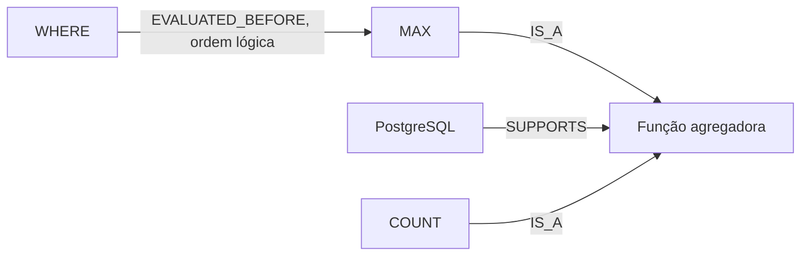

# Cobertura de consultas e agregações SQL

Esta etapa adiciona inventário SQL, relações de classificação de funções agregadoras e seis relações propostas pelo modelo e mantidas após revisão. As origens permanecem separadas: regras revisadas não são apresentadas como geração por LLM.

## Contrato e vocabulário

A versão 0.1.2 permite estes tipos, além dos oito anteriores:

| Tipo | Direção e significado |
|---|---|
| RETRIEVES | Operação de consulta → dados recuperados |
| FILTERS | Cláusula/operação → linhas ou grupos selecionados por condição |
| GROUPS | Cláusula de agrupamento → linhas agrupadas |
| AGGREGATES | Função agregadora → linhas de entrada combinadas no resultado |
| EVALUATED_BEFORE | Etapa lógica → etapa lógica posterior, no mesmo nível de consulta; não garante ordem física do plano |
| REMOVES_DUPLICATES | Operação → linhas repetidas removidas do resultado |

Nem todos esses tipos geraram relações aprovadas nesta rodada. As listas permitidas do gerador e dos dois esquemas JSON foram verificadas por teste. A normalização de nomes para validação agora ignora delimitadores de código inline, mas as citações continuam intactas, incluindo backticks e HTML.

## Vocabulário e classificação por regras

Foram encontrados 22 termos SQL em 40 ocorrências por trecho de D06/D07/D08. Os nomes e resumos foram curados por Codex; as ocorrências foram identificadas por regras. Não houve execução de SQL. Encontrar um termo em um exemplo não certifica a validade da consulta, pois a fonte também contém exemplos intencionalmente incorretos.

O inventário contempla SELECT, FROM, WHERE, GROUP BY, HAVING, ORDER BY, DISTINCT, AS, COUNT, SUM, AVG, MAX, MIN, FILTER, LIKE, AND, OR, NOT, JOIN e formas de junção. Para preservar a origem, o exportador exige decisões explícitas e o hash das ocorrências revisadas.

Separadamente, foi detectada a enumeração de funções no primeiro parágrafo de D08_C001. A revisão aprovou as cinco relações COUNT/SUM/AVG/MAX/MIN → IS_A → aggregate function. Essas relações foram extraídas por regra a partir da lista explícita, não inferidas dos valores de uma consulta. O script exige hash do trecho e lista esperada; se a fonte mudar, exige nova revisão.

A união por regras contém **79 conceitos e 5 relações**, com 110 referências literais. Inclui os glossários revisados anteriores. O termo aggregate function é um conceito; aggregation é a operação de cálculo e não foi fundido automaticamente com ele.

## Lote com modelo local

O Qwen3 8B foi executado com raciocínio e verificação separada nas 21 passagens elegíveis dos três chunks de D06/D08 e em dois controles negativos. A soma dos tempos registrados de chamadas foi 702,22 segundos, sem todo overhead da revisão. O custo maior e os erros observados impedem extrapolar os resultados para uma execução de produção.

Das 23 entradas, 11 propostas passaram à revisão, nove foram rejeitadas e três tiveram abstenção. Os dois controles se abstiveram. A revisão por Codex manteve seis propostas, sinalizou cinco e preservou as demais recusas/abstenções sem reparações. Não houve revisão humana independente nem avaliação detalhada de toda recusa.

Relações mantidas:

- SELECT → RETRIEVES → data.
- WHERE → REQUIRES → boolean expression, quando a cláusula é usada; não significa que toda consulta precisa de WHERE.
- PostgreSQL → SUPPORTS → aggregate function.
- WHERE → EVALUATED_BEFORE → MAX, como ordem lógica no mesmo nível de consulta; não proíbe subconsultas de calcular seus próprios agregados.
- HAVING → FILTERS → grouped row.
- FILTER → TYPICALLY_USED_IN → aggregation, como opção por função, sem obrigatoriedade.

Foram recusadas na revisão propostas que tratavam o asterisco como subtipo de all columns, uma referência bibliográfica como sistema que oferece LIKE, HAVING como necessariamente dependente de agregados e FILTER como filtro sobre a função em vez de suas entradas. A proposta de suporte a expressões pela lista de seleção ficou pendente por não corresponder ao sentido estrito de SUPPORTS adotado no contrato.

O erro de HAVING passou pelo verificador do próprio modelo. Depois de observado, foi adicionado um filtro conservador para REQUIRES em passagens com exceções explícitas. Essa proteção foi testada, mas não atuou retroativamente na execução salva: o descarte deste resultado decorre da revisão por Codex.

## Saídas atuais para integração

| Arquivo | Conteúdo |
|---|---|
| data/extraction/rule-knowledge-union-v1/extraction.json | 79 conceitos e 5 relações de origem por regras, versão 0.1.1 |
| data/extraction/model-knowledge-union-v2/extraction.json | 20 conceitos e 11 relações derivados do modelo, versão 0.1.2, incluindo as rodadas anteriores revisadas |

Carregados conjuntamente por IDs/triplas, esses arquivos representam **88 conceitos únicos e 16 relações semânticas únicas**. Não somar 79+20 como se todos fossem nós diferentes. Os documentos e trechos são carregados separadamente do corpus. A compatibilidade de nomes canônicos e categorias dos IDs compartilhados foi conferida.

A amostra manual inicial não foi copiada para esses totais e continua separada. Ao carregá-la também, reunir as evidências das triplas já existentes e não duplicar arestas. As definições sinalizadas e as divergências de fonte continuam fora dos fatos aprovados, sem remoção do corpus original.

Exemplo de caminho disponível nos arquivos, ainda sem execução no Neo4j:



## Verificação e reprodução

Os 52 testes passaram. As duas uniões foram validadas em esquema, IDs e citações literais; os IDs compartilhados são compatíveis. A versão antiga do esquema na main precisa ser atualizada antes de validar os novos arquivos SQL.

```powershell
python scripts/pilot-passage-extraction.py --documents D06 D08 --output data/extraction/sql-d06-d08-v2 --semantic-check --negative-controls --think
python scripts/extract-sql-terms.py --output data/extraction/sql-vocabulary-v2
python -m unittest discover -s tests -p "test_*.py" -v
pwsh -NoProfile -File scripts/validate-extraction.ps1 -ExtractionPath data/extraction/model-knowledge-union-v2/extraction.json
```

Novas ocorrências e respostas precisam de nova revisão: não reutilizar aprovações se o conteúdo ou seu hash mudou. Os scripts recusam sobrescrita das saídas. As respostas originais, parâmetros, digests, propostas e decisões desta rodada estão preservados em data/extraction/sql-d06-d08-v1. O pacote de entrega não contém credenciais, pesos de modelos ou uma instância Neo4j pronta.

## Limites

Ainda não há extração exaustiva de todas as relações dos nove documentos, nem cobertura integral dos diagramas e exercícios. A existência de fonte e aprovação por Codex não garante correção universal das formulações didáticas. Esta é uma base revisada para integração e avaliação independente, não comprovação de redução de alucinações do sistema final.
