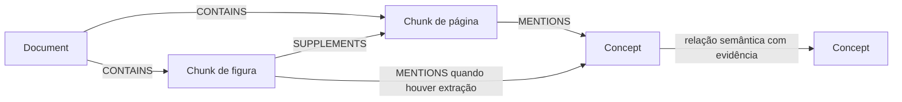

# Entrega da base documental e amostra para implementação no Neo4j

Este material permite à pessoa responsável pela parte 2 iniciar a modelagem física, os scripts de criação e a ingestão sem esperar a instalação do Ollama. Não contém banco pronto nem extração automática completa.

## O que está entregue

- Corpus: 9 documentos, 31 trechos originais e 28 suplementos de figuras, com fontes e atribuições preservadas.
- Contrato de integração 0.1.0 e esquema JSON.
- Amostra manual revisada: 12 conceitos e 9 relações, apoiados em 21 evidências literais de D03_C001, D07_C001 e D07_C002.
- Validador estrutural para a amostra e futuras saídas consolidadas.

A revisão foi feita por Codex, sem conferência humana independente. `accepted` nesta amostra significa correspondência com a fonte no escopo documentado. O grupo ainda deve conferir o conteúdo. Há questões conhecidas em outros trechos, registradas no corpus.

## Arquivos de entrada e mapeamento

| Arquivo | Destino e regra |
|---|---|
| corpus/metadata/sources.json | Um Document por document_id. title → title; final_url → source_url; language → language; version_or_edition → version. Preservar collected_at e atribuições/licenças. |
| corpus/chunks/chunks.jsonl | Um Chunk por chunk_id. Preservar document_id, text, source_url, language, section_path e section_paths. Definir content_type=page_text quando ausente. |
| corpus/chunks/figure_supplements.jsonl | Também gera Chunk. content_type=figure_transcription; preservar figure_ids, parent_chunk_ids, transcription_status, uncertainties e source_issue_ids. |
| data/extraction/sample.json | Somente concepts e relations deste arquivo viram conhecimento extraído inicial. Não inventar relações para os outros documentos. |
| corpus/metadata/figure_source_issues.json | Pendências das fontes para inspeção; não são relações semânticas aceitas. |

As propriedades aninhadas (licença, lista de objetos de evidência, caminhos de seção aninhados, se houver) podem ser serializadas em strings JSON. Listas simples de strings, como aliases e evidence_chunk_ids, devem permanecer listas. Guardar texto bruto sem remover HTML inline ou alterar as citações.

## Modelo definido para esta entrega



Labels: Document, Chunk e Concept. IDs únicos por label: document_id, chunk_id e concept_id. Não criar um label por conceito nem usar nomes em português como chave de identidade.

Tipos semânticos permitidos: IS_A, SUPPORTS, REQUIRES, GOVERNS, TYPICALLY_USED_IN, COMBINES, HAS_FORM e PRESERVES. A amostra usa apenas parte desse vocabulário. Use uma lista permitida de tipos ao construir a ingestão; não interpolar texto arbitrário do modelo em Cypher.

Relações estruturais:

- CONTAINS: Document → Chunk, usando document_id.
- SUPPLEMENTS: Chunk de figura → cada Chunk pai em parent_chunk_ids. Não vincular a outro documento por semelhança de nome.
- MENTIONS: Chunk → Concept, pela união das evidências dos conceitos e dos dois endpoints das relações, sem repetir pares. A menção não substitui a citação literal armazenada.

Relações semânticas: Concept → Concept, usando source e target como IDs. Preservar relation_id, assertion_kind, review_status, review_note, evidence_chunk_ids e evidence_quotes_json. Conceitos também preservam suas evidências, status e observações. Evidências novas devem ser reunidas, não substituir silenciosamente as antigas.

## Primeira carga recomendada

1. Validar sample.json antes da ingestão.
2. Carregar os 9 Documents e os 59 Chunks. A maior parte dos chunks ainda não terá MENTIONS: a amostra cobre somente três trechos, o que é esperado.
3. Criar CONTAINS e SUPPLEMENTS usando os IDs fornecidos.
4. Carregar os 12 Concepts e as 9 relações semânticas da amostra manual.
5. Criar MENTIONS a partir das evidências. Uma relação pode citar um chunk diferente daquele usado para definir seu conceito; considerar ambos.
6. Conferir os caminhos e as evidências antes de ampliar a carga de conhecimento extraído.

No arquivo de transferência, extraction_method=manual_reference deve continuar identificado nos registros/metadados da carga. Não apresentar esta carga como resultado da extração automática do sistema.

## Critérios de aceitação para a parte 2

- Banco recriável por scripts, com instruções de execução.
- Restrições de unicidade nos IDs dos três labels.
- Referências inválidas causam erro explícito; não são descartadas silenciosamente.
- Uma segunda execução não duplica nós ou arestas, nem apaga evidências.
- Contagens de Documents, Chunks, Concepts e relações semânticas correspondem à carga selecionada.
- Consulta de caminho com pelo menos dois saltos retorna os IDs e trechos de evidência associados a cada aresta.
- Consulta mostra que chave estrangeira é tipicamente utilizada em JOIN; não existe aresta dizendo que JOIN depende obrigatoriamente de FK.
- Pendências de transcrição e de fonte permanecem identificáveis.
- Configuração de conexão não contém senha no Git.

O responsável pela parte 2 deve implementar e verificar os índices de propriedades, fulltext e vetoriais exigidos pelo enunciado. O modelo e a dimensão dos embeddings ainda precisam ser combinados com a parte 3; não inventar vetores nem fixar uma dimensão sem o modelo correspondente. A ingestão da amostra pode ser testada antes dessa etapa, sem declarar os índices vetoriais concluídos.

## Caminho esperado da amostra

Integridade referencial → GOVERNS → chave estrangeira → TYPICALLY_USED_IN → JOIN → HAS_FORM → outer join → HAS_FORM → left outer join.

Cada aresta tem evidência própria; o caminho reúne D03 e D07. Isso permite testar a travessia, mas ainda não comprova redução de alucinações nem substitui a avaliação do sistema completo.

O conceito integrity constraint está presente como definição sem aresta semântica nesta amostra. Não acrescentar arestas artificiais para eliminar nós isolados.

## Como validar

Com PowerShell 7 instalado, na raiz do material extraído:

```powershell
pwsh -NoProfile -File scripts/validate-extraction.ps1
```

Não requer chave de IA, Ollama ou Neo4j para essa verificação. O validador confere formato, IDs, triplas e citações exatas; a validação conceitual e o teste no Neo4j são atividades distintas.

## Limites e continuidade

As 4 divergências de fonte e as 2 transcrições parciais permanecem documentadas. Não são fatos corrigidos. A amostra inicial evita afirmar uma dependência obrigatória de FK para JOIN e não generaliza a formulação da fonte sobre referência a PK para todas as regras de SGBDs.

A parte 1 ainda terá que executar a extração automática, revisar os candidatos, resolver entidades e entregar um JSON ampliado no mesmo contrato. A pessoa 2 poderá substituir a amostra por essa saída validada sem redesenhar a estrutura básica.
