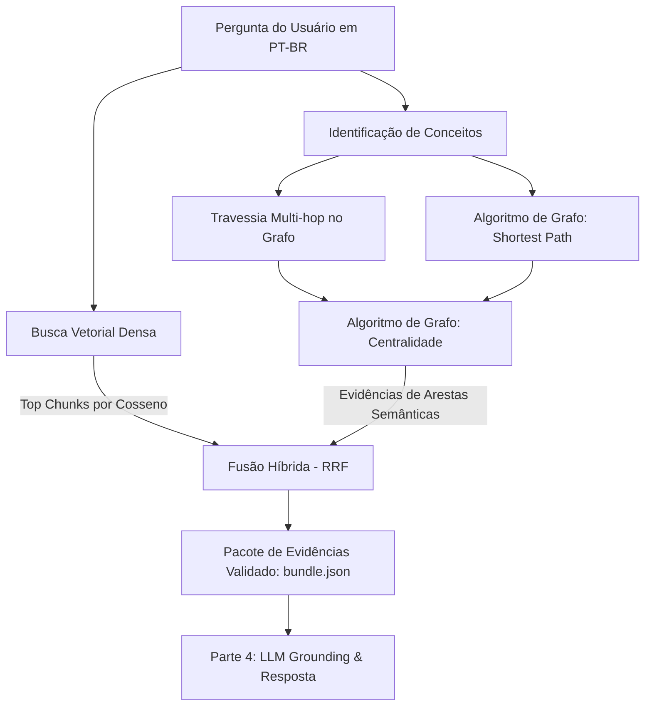

# Handoff e Especificação Técnica — Parte 3: Recuperação Híbrida e Travessia em Grafo

**Responsável:** Pessoa 3 (Adijair)  
**Módulo:** `scripts/retrieval.py`  
**Testes:** `tests/test_retrieval.py`  
**Índice Vetorial:** `db/schema.cypher` (384 dimensões, similaridade de cosseno)  
**Embeddings pré-computados:** `data/retrieval/chunk_embeddings.json`

---

## 1. Visão Geral da Arquitetura

A **Parte 3** é responsável pelo pipeline de **Recuperação Híbrida (Hybrid Retrieval)** no sistema GraphRAG/KAG. Ela atua como a ponte entre o Grafo de Conhecimento no Neo4j (Parte 2 - Lucas) e o Modelo de Linguagem / Grounding (Parte 4 - Jotapê).



---

## 2. Decisão do Modelo de Embeddings e Índice Vetorial

### 2.1 Modelo Escolhido
* **Nome:** `sentence-transformers/paraphrase-multilingual-MiniLM-L12-v2`
* **Dimensão vetorial:** `384`
* **Métrica de similaridade:** `cosine`
* **Motivação técnica:**
  1. **Capacidade Multilíngue (Cross-lingual):** O corpus do projeto foi extraído de livros e manuais técnicos em **inglês** (`en`), enquanto as perguntas dos usuários e avaliadores serão formuladas em **português** (`pt-BR`). O modelo mapeia conceitos equivalentes entre português e inglês diretamente no mesmo hiperespaço semântico.
  2. **Eficiência e Reprodutibilidade:** Roda de forma rápida e leve em CPU local, sem depender de chaves de API pagas ou serviços em nuvem externos.
  3. **Compatibilidade com Neo4j:** Alinha-se diretamente com o índice vetorial nativo do Neo4j 5+.

### 2.2 Configuração no Neo4j
Atualizado em `db/schema.cypher`:
```cypher
CREATE VECTOR INDEX chunk_embedding IF NOT EXISTS
FOR (c:Chunk) ON (c.embedding)
OPTIONS {indexConfig: {`vector.dimensions`: 384, `vector.similarity_function`: 'cosine'}};
```

Os embeddings de todos os 59 trechos (31 textos de página + 28 transcrições de figuras) foram pré-computados e versionados em `data/retrieval/chunk_embeddings.json`. Para gravá-los no Neo4j, basta rodar:
```bash
python scripts/retrieval.py ingest-embeddings
```

---

## 3. Mecanismos de Recuperação e Algoritmos de Grafo

### 3.1 Identificação e Vinculação de Conceitos (Entity Linking)
* Varre os 93 conceitos do grafo, analisando `canonical_name`, `name_pt` e lista de `aliases`.
* Normalização fonética e remoção de acentos (`unicodedata.normalize('NFKD')`) para casar consultas em linguagem natural (ex: *"juncao"*, *"integridade referencial"*, *"chave estrangeira"*, *"formas normais"*).

### 3.2 Travessia Multi-Hop ($\ge 2$ saltos)
* A partir das sementes identificadas, o mecanismo navega pelas relações semânticas do grafo (`GOVERNS`, `REQUIRES`, `TYPICALLY_USED_IN`, `COMBINES`, `HAS_FORM`, `IS_A`, etc.) até `max_hops` (padrão: 4 saltos).
* Cada aresta percorrida carrega seus `evidence_chunk_ids` originais e a citação literal que sustenta aquele fato.

### 3.3 Algoritmos de Grafo Aplicados (Requisito da Disciplina)
1. **Shortest Path (Menor Caminho Semântico):**
   * Quando uma consulta envolve múltiplos conceitos (ex.: *"integridade referencial"* e *"junção externa à esquerda"*), o algoritmo encontra a cadeia mínima de relações conectando-os no grafo conceitual (ex.: `C_referential_integrity` $\to$ `C_foreign_key` $\to$ `C_join` $\to$ `C_outer_join` $\to$ `C_left_outer_join`), conectando documentos distintos (D03 e D07).
2. **Centralidade de Grau (Degree Centrality):**
   * Pondera os conceitos no subgrafo recuperado para priorizar nós pontes e de alta conectividade contextual.

### 3.4 Fusão Híbrida (Reciprocal Rank Fusion — RRF)
Combina o ranking da busca vetorial ($R_{vec}$) com o ranking das evidências de grafo e menções ($R_{graph}$):
$$RRF(chunk) = \frac{1}{60 + R_{vec}(chunk)} + \frac{1}{60 + R_{graph}(chunk)}$$
Isso garante que trechos que possuem suporte textual denso **e** sustentam caminhos estruturados no grafo tenham precedência máxima.

---

## 4. Contrato de Integração com a Parte 4 (Jotapê)

O pacote de saída gerado por `retriever.retrieve(...)` respeita 100% as regras validadas por `scripts/answer-grounding.py`:

```json
{
  "question": "Como a integridade referencial se relaciona com chaves estrangeiras?",
  "language": "pt-BR",
  "retrieval": {
    "strategy": "hybrid",
    "channels": ["graph", "vector"],
    "graph_executed": true,
    "max_hops": 4,
    "graph_algorithm": "shortest_path + degree_centrality",
    "model": "paraphrase-multilingual-MiniLM-L12-v2",
    "dimension": 384
  },
  "concepts": [
    {
      "concept_id": "C_referential_integrity",
      "canonical_name": "referential integrity",
      "name_pt": "integridade referencial"
    },
    {
      "concept_id": "C_foreign_key",
      "canonical_name": "foreign key",
      "name_pt": "chave estrangeira"
    }
  ],
  "evidence": [
    {
      "chunk_id": "D03_C001",
      "document_id": "D03",
      "title": "Chapter 9 Integrity Rules and Constraints",
      "source_url": "https://opentextbc.ca/dbdesign01/chapter/chapter-9-integrity-rules-and-constraints/",
      "section_path": ["Chapter 9 Integrity Rules and Constraints"],
      "quote": "<em>Referential integrity</em> requires that a foreign key must have a matching primary key or it must be null. This constraint is specified between two tables (parent and child); it maintains the correspondence between rows in these tables. It means the reference from a row in one table to another table must be valid.",
      "review_status": "accepted",
      "origin": "graph",
      "relation": {
        "relation_id": "R_sample_003",
        "type": "GOVERNS",
        "source": "C_referential_integrity",
        "target": "C_foreign_key"
      }
    }
  ]
}
```

### Garantias Atendidas:
* **Garantia de Citação Literal:** Todo `quote` emitido é verificado por `quote in chunk.text`. Nenhuma citação é inventada, normalizada ou traduzida.
* **Tags de Origem (`origin`):** Classifica explicitamente cada evidência como `'graph'`, `'vector'` ou `'concept'` para permitir exibição detalhada na interface (Parte 5).
* **Navegação Offline e Online:** Funciona localmente com os arquivos do repositório em modo autônomo e conecta-se automaticamente ao Neo4j quando as variáveis de ambiente `.env` estiverem configuradas.

---

## 5. Como Executar e Validar

### 5.1 Busca via CLI
```bash
# Busca padrão com saída JSON no terminal
python scripts/retrieval.py search --query "Como a integridade referencial se relaciona com chaves estrangeiras?"

# Salvando bundle diretamente para a Parte 4 consumir
python scripts/retrieval.py search --query "O que é um LEFT JOIN?" --output work/bundle-exemplo.json
```

### 5.2 Testes Automatizados
```bash
# Executa todos os testes unitários da Parte 3
python -m unittest tests.test_retrieval -v

# Executa toda a suíte do repositório (87 testes)
python -m unittest discover -s tests -p "test_*.py"
```
