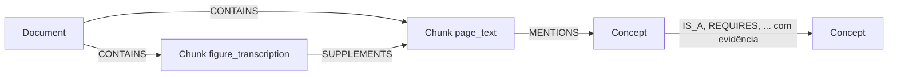

# Modelo do grafo e ingestão no Neo4j (parte 2)

Este documento descreve o grafo criado a partir da entrega da parte 1 (`data/release/current.json`), como recriá-lo e o que cada comando garante. Código: `scripts/neo4j_ingest.py`. Esquema: `db/schema.cypher`. Consultas de exemplo: `db/consultas-exemplo.cypher`. Testes: `tests/test_neo4j_ingest.py`.

## Modelo



Três labels, cada um com ID único e estável. Nunca usar nome (em inglês ou português) como identidade.

| Label | Chave | Propriedades principais |
|---|---|---|
| Document | `document_id` | title, source_url, language, version, collected_at, authors, license_name, license_url, license_json, attributions_and_notices, quality_status |
| Chunk | `chunk_id` | text, document_id, content_type (`page_text` ou `figure_transcription`), language, source_url, section_path, section_paths_json, chunk_index, word_count. Só figuras: figure_ids, parent_chunk_ids, transcription_status, uncertainties, source_issue_ids |
| Concept | `concept_id` | canonical_name, name_pt, aliases, category, description_pt, review_status, review_note, extraction_methods, evidence_chunk_ids, evidence_quotes_json, provenance_json |

Relações estruturais: `CONTAINS` (Document → Chunk), `SUPPLEMENTS` (Chunk de figura → Chunk-pai), `MENTIONS` (Chunk → Concept, a partir das evidências de conceitos e dos dois extremos de cada relação).

Relações semânticas (Concept → Concept), tipos permitidos: IS_A, SUPPORTS, REQUIRES, GOVERNS, TYPICALLY_USED_IN, COMBINES, HAS_FORM, PRESERVES, RETRIEVES, FILTERS, GROUPS, AGGREGATES, EVALUATED_BEFORE, REMOVES_DUPLICATES. Propriedades: relation_id, relation_ids, assertion_kind, review_status, review_note, extraction_methods, evidence_chunk_ids, evidence_quotes_json, provenance_json. Uma única aresta por trio (origem, tipo, destino), com todas as evidências reunidas.

Neo4j só guarda valores simples ou listas de valores simples. Objetos e listas aninhadas (evidências, `section_paths`, licença) são guardados como texto JSON em propriedades terminadas em `_json`.

## Como recriar o banco

Na raiz do repositório:

```bash
cp .env.example .env            # preencha NEO4J_PASSWORD (mínimo 8 caracteres)
docker compose up -d            # sobe o Neo4j em localhost:7474 (Browser) e :7687 (Bolt)
python -m pip install -r requirements-neo4j.txt
python scripts/neo4j_ingest.py schema                          # restrições e índices
python scripts/neo4j_ingest.py ingest --dry-run --include-sample  # valida tudo, sem gravar
python scripts/neo4j_ingest.py ingest --include-sample         # grava e verifica
```

Recomeçar do zero: `docker compose down -v`. A senha vive só no `.env` (não versionado).

`--include-sample` acrescenta `data/extraction/sample.json`, opcional segundo a parte 1. Todos os 12 conceitos dele já existem nos 93; ele só traz 7 relações a mais, incluindo FK → JOIN (D03 → D07) e JOIN → outer join → left outer join. Sem ele, os 3 arquivos principais têm só 2 caminhos de 2 saltos, ambos dentro de um único documento.

| Carga | Document | Chunk | Concept | MENTIONS | Relações semânticas |
|---|---:|---:|---:|---:|---:|
| 3 arquivos principais | 9 | 59 | 93 | 130 | 16 |
| + `sample.json` | 9 | 59 | 93 | 134 | 23 |

## Regras de mesclagem (decisões da parte 2)

1. **Só entram os `primary_files`** de `data/release/current.json`, com conferência do SHA-256 de cada um. `--no-hash-check` existe para casos como quebra de linha no Windows.
2. **Conceito em mais de um arquivo** (11 casos): aliases e evidências são unidos sem repetição, e os métodos de extração são listados. O primeiro arquivo da lista define `name_pt`, `description_pt` e `review_note`, nesta ordem: regras, LLM, curadoria manual e, por último, o `sample`. Assim um resumo antigo do `sample` nunca substitui um revisado. As versões de cada arquivo ficam em `provenance_json`.
3. `canonical_name` ou `category` diferentes para o mesmo ID são **erro**, não são resolvidos em silêncio.
4. `review_status` da mesclagem vale o mais fraco (`flagged` < `pending` < `accepted`); `assertion_kind` vira `inferred` se qualquer fonte for inferida.
5. Atualização **nunca apaga** nós, relações nem propriedades criadas por outras partes (por exemplo `embedding`, da parte 3).

## O que cada garantia significa e como é verificada

| Critério da parte 1 | Como é atendido | Verificação |
|---|---|---|
| Recriável por scripts | docker-compose + `schema` + `ingest` | comandos acima |
| Unicidade nos 3 IDs | restrições `*_unique` | `verify` e `SHOW CONSTRAINTS` |
| Referência inválida = erro explícito | validação prévia lista **todos** os problemas; cada passo confere quantas linhas gravou | `tests/test_neo4j_ingest.py` |
| Segunda execução não duplica nem apaga | `MERGE` + restrição; `SET +=` | teste com banco: contagens iguais e `embedding` preservado |
| Carga tudo-ou-nada | uma única transação | teste com banco: erro no meio desfaz tudo |
| Contagens batem com a carga | `verify` | roda ao fim do `ingest` |
| Caminho de 2+ saltos com evidência por aresta | `evidence_chunk_ids` em cada aresta | `verify` e consulta 4 de `db/consultas-exemplo.cypher` |
| FK é "tipicamente usada" em JOIN, sem dependência obrigatória | só existe `TYPICALLY_USED_IN` (com o `sample`) | `verify` confirma que não há `JOIN -[REQUIRES]-> FK` |
| Pendências de fonte/transcrição identificáveis | `transcription_status`, `uncertainties`, `source_issue_ids` no Chunk | consulta 7 |
| Senha fora do Git | `.env` ignorado; compose exige `NEO4J_PASSWORD` | `.gitignore` |

Testes com banco: `NEO4J_TEST=1 python -m unittest tests.test_neo4j_ingest -v` (usa a conexão do `.env`; os testes sem banco rodam sempre).

## Índices

Restrições: `document_id_unique`, `chunk_id_unique`, `concept_id_unique`. Propriedade: `chunk_document_id`, `chunk_content_type`, `concept_category`, `concept_canonical_name`. Texto: `concept_names` (nome em inglês, em português e aliases; ignora acentos; usado pela interface para sugerir conceitos). Vetorial: `chunk_embedding`.

**Índice vetorial: ainda não criado.** Depende do modelo de embeddings e da dimensão, a combinar com a parte 3. O comando está comentado no fim de `db/schema.cypher`. Não foram criados embeddings nem fixada uma dimensão.

## Pendências para combinar com o grupo

- **Parte 3:** modelo e dimensão dos embeddings (para o índice vetorial) e se usarão o plugin GDS (há uma linha comentada no `docker-compose.yml`). A ingestão preserva a propriedade `embedding` nos Chunks.
- **Parte 1:** o `sample.json` entra na versão final? A cobertura de relações é pequena (16 nos arquivos principais). Para o objetivo "responder com dois documentos reais", são necessárias mais relações entre D03, D07 e os demais.
- **Parte 4:** o esquema acima, com a lista de tipos de relação, é a base para gerar e validar Cypher.

## Limites do que foi testado

O Cypher, a ingestão e os testes foram executados em um Neo4j Community 5.26.0 real. O `docker-compose.yml` (imagem `neo4j:5.26-community`) usa a mesma versão, mas **ainda não foi executado no Docker**. Restrições `IS NOT NULL` existem só na edição Enterprise e não são usadas. A verificação confere o banco contra os arquivos entregues, não a correção conceitual das fontes, e isso continua sem revisão humana independente, como registra a parte 1.
